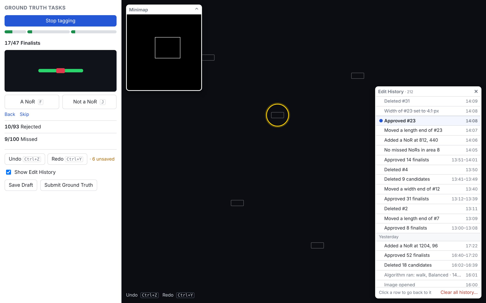

# The ground-truth action log, with undo and an Edit History window (future direction)

A design, not a plan: nothing here is built. The owner asked for a tagger's ground truth to be kept as
a sequential log of every action on the GT model, from the image opening, through the algorithm's run,
to each correction; for that log to travel with the model to Drive and back; for a replay to reproduce
the model without re-running the algorithm; and for undo and redo, the stack shown as a list.
[`mockup.html`](mockup.html) / [`mockup.png`](mockup.png) draw the window. Revised 2026-11-17 on the
owner's review: minimal actions, undo by replay, explicit Save Draft, ids kept.



## How to read the evidence

| mark | source | trust |
|---|---|---|
| **[repo]** | Read in this repo, 2026-11-16/17 | Exact |
| **[measured]** | A throwaway Node script over `studies/vascular/tests/fixtures/cd31_frontal_x20_r_1_slices1-12.vessels.json` (680 points, 646 segments), one run, this container; script not kept | Indicative of order of magnitude |
| **[estimate]** | Sized from a synthetic row of the shape the code writes; no real NoR run (the container has no SciPy) | Rough |
| **[exact]** | Page fetched with `curl`, text read from disk | Exact text |
| **[fetch]** | Page read through a summarizing fetch tool | Content right, wording not byte-exact |
| **[S]** | Search-result summary only (Adobe's own page answered 403) | Indicative; re-verify |

## The decisions in one table

| | Decision | Why |
|---|---|---|
| Name | A **GT action**, kept in the **action log**; the user sees **Edit History**. Modules `web/truth_actions.js` (pure: log, replay, undo) and `web/truth_history.js` (the window); spec ids `req/shell/ground-truth/history…` | The owner's word. `web/action_log.js` (the problem report's click log) and `web/actions.js` (the keyboard) already exist [repo], so the code always says *GT action* / `truthActions`, never a bare "action" |
| Action | **The least data that says what happened**: `{at, type, …what}`. No label, no inverse, no sequence number | The owner's call: the study can read, run and describe an action from that alone; the timestamp and the list's order identify it |
| One gesture, one action | What the user did is the action, executed whole by the study's `run`: "These widths look right" over slices 2–4 is one `widths-right` action, not the moves and verdicts it implies | The owner's call; the study's `run` computes the consequences from the model, without the UI |
| Undo | **Uniform, by replay**: undo drops the last action from the active list and replays the rest from the run's output; the dropped action waits on the redo list | The owner's call (same for every study); no study writes an inverse, so a delete or a split undoes as surely as a move |
| Rendering | The shell replays by calling the study's `run` for each action; the study's UI draws only the **end model** | The owner's call |
| Model + log | Both kept; the stored model is the authority, the replay checked against it by hash | The owner's rule: an old algorithm may not run again |
| Re-run | A new run's output takes the ids of the previous one by place; every action then replays onto it, by id; one whose target is gone is skipped and shown greyed | The owner's calls: re-run replays the actions (2026-11-16); ids are kept (2026-11-17) |
| Saving | **In memory until Save Draft**, a button beside Submit Ground Truth; the draft in **IndexedDB**. Opening an image with a draft *offers* it (Load draft, in the GT box); it is never loaded unasked | The owner's call: the tagger can experiment without touching the saved draft |
| Every study | Uses the shell's draft; no study keeps GT on the device itself | The owner's call; today NoR and Vascular keep their own [repo] |
| Thumbnails | Leave `localStorage` for Cache Storage, as blobs | The owner's call: up to 100 JPEG data URLs sit in `localStorage` today (`keepThumb`) [repo] |
| Drive | **One file**: the study's model as its document, plus a `history` key with the log; no new call | The owner's call |
| Window | **Edit History**, floating at the image's bottom right, framed like the minimap, 2.5 × its height; **Show Edit History** in the GT box shows it. Undo and Redo stay buttons in the GT box; Clear all history is in the window | The owner's call (2026-11-16) |

## 1. The action

An action is what the tagger did to the GT model, in the fewest fields that let the study do it again:

```json
{ "at": "2026-11-16T12:08:41.120Z", "type": "move-node", "node": "p412", "to": [412.5, 220.25, 3] }
{ "at": "2026-11-16T12:09:02.004Z", "type": "widths-right", "slices": [2, 4], "area": 14 }
{ "at": "2026-11-16T12:09:30.551Z", "type": "approve", "cand": "c87" }
{ "at": "2026-11-16T12:09:31.902Z", "type": "delete", "cand": "c88" }
```

- **No index, no label, no undo.** The log is an ordered list and `at` names an entry. The label
  ("Moved node p412", "Widths right in area 14, slices 2–4") is drawn when the window shows the row,
  by the study's `describe(action)`; it is never stored. The undo is a replay (section 3), so no
  inverse is stored or written by the study.
- **A user gesture is one action**, whatever it changes. A tip dragged onto another vessel is one
  `attach` (the study's `run` moves and joins); "These widths look right" is one `widths-right` (the
  study's `run` decides each open vessel and marks each width in the area). Nothing is broken down
  into smaller actions.
- **Everything the study's `run` needs is in the action or the model**, never the clock, the page or
  the view: a day stamp is `at`; a view factor (Vascular's `splitJunction` z scale) is a field.
- **Results the study cannot recompute are fields of their action.** The algorithm's output is the
  `run` action's `output`; Shelves' OCR answer, when it lands, is a `read` action carrying the text and
  confidence. Replay takes them as written and never re-runs the engine.
- **A drag is one action, at the drop.** While dragging, only the page moves; Escape ends the drag with
  no action (`req/shell/drag/escape`). Typing a title is one action when the field commits (Enter, a
  verdict, another book), not per key.
- **Not actions:** the open item, the walk's place, zoom, pan, Show menu, sort, card options, NoR's
  summary mask, saving and submitting. They change no GT model.

The shell's own types:

| type | fields |
|---|---|
| `open` | `image: {name, sha256, width, height}`, `study` (the study's id) |
| `run` | `algorithm: {key, params}`, `output` (the model the algorithm emitted; stored deflated) |
| `base` | `model`, `from` (where it came from): stored GT that has no log of its own |

A value not known is left out, never zero: `params` of a model that arrived as a file.

**What a study supplies** (pure functions, no DOM, named in `study.json` as
`groundTruth.actions: "web/gt_actions.js"`):

```js
export function start(output, previous)  // the run's output → a model; `previous`, the last run's model, lends its ids by place
export function run(model, action)       // → the next model, or {skip: "why"} when its target is not there; never mutates
export function describe(action)         // → "Moved node p412" (the window's row)
export function where(action, model)     // → [x0, y0, x1, y1] in image pixels or null (the row's ring on the image)
export function document(model)          // → the study's GT file
```

The shell owns the rest: the log, replay, undo, redo, Save Draft, the offer, the window, the keys. A
study records an action with `shell.gt.act(action)` and draws whatever `shell.gt.model()` now is.

## 2. Ids

The owner's call: ids stay. Every item a GT action can name has an id that is the model's own, kept
in the study's file and never renumbered by saving and loading.

- **NoR**: a candidate keeps its id from the run (`c87`); a NoR the tagger adds gets a new one (`u3`),
  never reused when another is removed.
- **Shelves**: each book gets an id, in the model and the file, hidden from the user.
- **Vascular**: points and segments keep their ids through `toJSON` and `parse`; today they are
  renumbered and segments are named by array index [measured], which must go.
- **A re-run** gets its ids from the run before it: `start(output, previous)` gives each new item the
  id of the previous item at its place, within the study's tolerance, and new ids to the rest. That is
  deterministic (both outputs are in the log), so every action replays onto the new output by id; an
  action whose item has no match is skipped and shown greyed under the run ("didn't carry over"). NoR
  does this matching today, re-attaching votes by rounded position (`loadMarks`) [repo].

## 3. Replay, undo and redo

`replay(log)`: the model of the last `run` (or `base`), then the study's `run(model, action)` for
every other action, in order. Actions before a re-run replay too, onto the new output, by id. No
algorithm, no DOM, no clock; it runs under Node as in the page, so the lab can call it.

**Undo** takes the last action off the active list and puts it on the redo list, then replays.
**Redo** puts it back and runs it. A new action clears the redo list. Every study's undo therefore
behaves the same, and the study writes nothing for it. Undo stops at the first `run` or `base`.
Undoing a re-run returns to the model built on the run before.

Linear, redo cut off by a new action: Blender, "you can hop around on the Undo timeline as much as
you want as long as you do not make a new change. Once you do make a new change, the Undo History is
truncated at that point" [exact]; Photoshop's default is the same [S]. Branching undo is on record as
powerful and confusing (undo-tree's own header [S]), and selective undo fails where one change has
downstream consequences [S], as a split or a delete has here. The per-item take-backs (Reset
measurements, a verdict pressed again) stay: they are new actions.

**Speed.** A replay from the run is ≈ 0.15 s for a thousand Vascular moves [measured, 0.14 ms each],
too slow for a held Ctrl+Z. So the shell keeps, in memory only, the model every 25 actions; undo
replays from the nearest one, ≤ 25 runs, ≈ 4 ms. They are never saved; loading rebuilds them in the
one replay it does anyway. A jump to a row in the window is the same replay.

**The check.** On load the shell replays the log and compares the SHA-256 of the result's `document`
with the stored model's. It records which path ran, in the draft and on the status line:

| outcome | what the tagger gets |
|---|---|
| `verified` | The replayed model, the whole history undoable down to the run |
| `mismatch` | The **stored model wins**, as a `base`; the log stays, shown grey, "earlier history, not replayable in this version" |
| `none` (a file from before the log) | A `base`: "Ground truth by <tagger>, <created>, no history" |

No study version is needed: if a study's code changed what an action does, the replay no longer
matches the stored model and the check says so.

## 4. Saving, loading and the draft

- **In memory until saved.** The log and its model live in the page while the tagger works. **Save
  Draft**, beside Submit Ground Truth, writes the active log and the end model to IndexedDB, replacing
  the image's draft. Until then the saved draft is untouched, so the tagger can try things freely.
  Unsaved actions show as "· unsaved" on the GT box's Undo row, and leaving the page with any asks first
  (`beforeunload`). Submit saves the draft too.
- **The offer.** Opening an image that has a draft on this device (by study and image SHA-256) shows
  **Load draft · saved 14:08, 212 actions** in the GT box. Nothing loads unasked; loading over unsaved
  actions asks first. After phase 5 the same offer names the tagger's own submission on Drive.
- **Every study uses it.** NoR's five keys (`MARKS`, `EDITS`, `ADDED`, `AREAS_KEY`, `MISSING`) and
  Vascular's `mv-model:` go; each is read once on first open and offered as a draft (a `base`), then
  deleted when that draft is saved.
- **Where.** IndexedDB database `gt-drafts`, one record per draft: `{study, sha256, name, saved, log,
  model, replay}`, the `run` output deflated (`CompressionStream`, already used by
  `previews_writer.js`). It is site data, listed and deleted by Manage storage under the image, the one
  place the user already clears. A failed write is said, never swallowed (`writeJSON` swallows quota
  errors today [repo]). The `gt-draft|…` `localStorage` keys are read once and removed.
- **Thumbnails** move from `localStorage` (`nor-drive-thumb:<id>` data URLs, up to 100 [repo]) to a
  Cache Storage cache beside `FOLDER_PREVIEWS`, as JPEG blobs, same cap. `localStorage` (5 MiB an origin
  [fetch, MDN]) is left with small settings only.
- **Clear all history**, in the window, forgets this image's draft on the device and returns the model
  to the run's output, after a confirm (`req/shell/ground-truth/clear`).

## 5. In Drive

The study's file becomes its model's `document`, and `truthTagger.submit` adds one key:

```json
"history": { "format": "rauntruth-gt-history/1", "replay": "verified", "actions": [ … ] }
```

`actions` is the active log, with the `run` outputs; the redo list stays in the page. Readers that
know only the old fields keep working (the NoR lab's `validate` ignores extra keys [repo]); the shell
removes `history` before handing a file to a study, since Vascular's `parse` keeps unknown keys
[repo]. A file without `history` loads as a `base`. Load GT tagging downloads every tagger's file
(`current()` [repo]), so it grows to ≈ 0.1–0.3 MB a tagger.

**NoR's file becomes a model** (the owner's call): the candidates that remain, approved ones flagged,
and the tagger's added NoRs and checked areas. Approve is an action; reject is a `delete`. A rejected
candidate is then absent from the model and present in the log (its `delete`) and in the run's output,
which is where the lab reads negatives from. Undecided candidates stay in the model, unflagged.

## 6. Sizes

| | algorithm output (`run`) | an action | a long sitting |
|---|---|---|---|
| NoR | 517–761 candidates on the reference slide (`finder_metrics.json` [repo]); ≈ 280–420 KB JSON, ≈ 37–54 KB deflated [estimate]; the pixel masks stay out | ≈ 60–120 B | ≈ 700 actions ≈ 70 KB |
| Shelves | tens of books: a few KB [estimate] | ≈ 80–200 B (a `read` up to ≈ 400 B) | < 30 KB |
| Vascular | 62 KB JSON, 14.6 KB deflated [measured] | ≈ 80 B | 500 actions ≈ 40 KB |

Smaller than the first design's, which stored a label and an inverse with each change.

## 7. The Edit History window

**Place** (the owner's call, 2026-11-16). A floating tool window over the image, **Edit History · 212**,
at its bottom right, framed and headed as the minimap is. Its height is **2.5 × the minimap's**, never
taller than the view less its margins; its width is the minimap's × 1.4, so a row fits on one line. The
GT box has a **Show Edit History** switch (remembered per device, like the minimap's fold); the
window's ✕ hides it too. **Undo** and **Redo** stay buttons in the GT box, usable with the window
hidden. **Clear all history…** is at the window's foot. NoR's selected box at the top right is the one
thing it can meet, and the window's top yields to it.

**A long history stays inside the window.** The list scrolls within its fixed height; the current row
is sticky, pinned to the top or bottom edge while scrolled away; runs of one type fold into one row
("Approved 31 finalists", 13:12–13:39, its chevron unfolds it; Ctrl+Z still takes one action); a day
rule ("Yesterday") breaks long sittings. Past ≈ 1,000 rows the list draws only the rows in view.

**The rows:**

- **Newest on top, a dot at the current state**, as Blender's Undo History [exact].
- **Undone rows above the dot, dimmed and struck** until a new action clears them (Photoshop [S]).
- **A click on a row goes to it**, a replay to that point: "Selecting one of the entries in the list
  takes the current status to that position" (Blender [exact]); Krita sells its docker on the same
  [fetch].
- **Labels** are the study's `describe`, time at the right; Undo's tooltip names what it will undo.
- **The run and the image opening** close the list at the bottom; the run is clickable, back to the
  algorithm's output.
- **Hovering a row rings its item on the image**, from the study's `where`, in a colour the data does
  not carry; a click pans there when it is out of view.

**Keys.** Undo `Ctrl+Z` / `⌘Z`, redo `Ctrl+Shift+Z` / `⌘⇧Z` and `Ctrl+Y`, as shell actions in
`web/actions.js`, bound to the buttons, so they show in the keys legend like every other key
(`req/shell/image/keys`). A key typed in a field is left to the browser's own text undo; a drag in
progress ignores both. Vascular's own Ctrl+Z listener goes. Undo only while tagging.

**Seen elsewhere, not copied:** version histories (Figma, VS Code's Timeline [S]) list saved versions,
coarser than this log. Label Studio shows whether undo is possible [S]; no visible undo list was found
for CVAT [S].

## 8. Each study's actions [repo]

**NoR.** Model: the run's candidates by id, with `approved`, `lines` (length, red, width); added NoRs
by id; checked areas.

| type | today | fields |
|---|---|---|
| `approve` | A NoR | `{cand}` |
| `delete` | Not a NoR; Remove Added NoR | `{cand}` |
| `set-lines` | a length or width end dropped; Reset measurements | `{cand, lines \| null}` |
| `add` | right-click Add a NoR Here | `{cand: "u3", to: [x, y], lines}` |
| `check-area` | No missed NoRs here | `{area, on}` |
| `undecide` | a verdict pressed again | `{cand}` (for a deleted one, `run` restores it from the run's output) |

Today all of it is `st` mutated in place and written to five keys; added NoRs are named by array
place, which shifts on removal. The finalist/rejected split is the filters' (`st.fails`); a filter or
preset change is a `run`.

**Shelves.** Model: books by id `{corners, turn, text, typed, confidence, reader, verdict}`, `noneMissed`.

| type | today | fields |
|---|---|---|
| `move-corners` | a corner's drop | `{book, corners}` |
| `flip` | Flip | `{book}` |
| `set-text` | typing, committed | `{book, text}` |
| `approve` | Right; with a title typed and not yet committed, Enter or the button carries it | `{book, text}` |
| `add` | Draw a book, Add a book here | `{book, corners}` |
| `delete` | Not a book, Delete this book | `{book}` |
| `none-missed` | None missed | `{on}` |
| `read` | the OCR's answer landing | `{book, text, confidence, reader, turn}` |

Today books have no ids, the title saves per keystroke, and the OCR answer changes the book outside
any action.

**Vascular.** Model: `model.js`'s, already pure ("each edit returns a new model").

| type | function | fields |
|---|---|---|
| `move-node` | `moveNode`, at the drop | `{node, to}` |
| `attach` | a tip dropped on a vessel | `{node, to, onto}` |
| `connect`, `draw` | `connect`, `drawSegment` | `{from, to}` |
| `split`, `cut` | add a curve point, cut | `{segment, t}` / `{segment, ta, tb}` |
| `remove-bend`, `delete-node`, `delete-segment` | same names | `{node}` / `{segment}` |
| `split-junction` | `splitJunction` | `{node, zScale}` |
| `review`, `decide` | verdicts on vessels | `{segments, verdict}` |
| `check-junction` | `checkJunction` | `{node, on}` |
| `set-width` | `setWidth`, `measure`, `nudge` | `{segments, width \| null}` |
| `widths-right` | These widths look right | `{area, slices}` |

Today the drag records at the first move and Escape keeps the moved model (`model_view.js` `grab` and
`cancel`, read, not run); ids are renumbered by `toJSON`; `widthsRight` and `truth()` read the clock.

## 9. Phasing

The feature path each time: the requirement in the spec, a test that fails, then the code. Each is its
own PR.

0. **Thumbnails out of `localStorage`**, to Cache Storage. Independent of the rest.
1. **Shell core, with the fixture study.** `truth_actions.js` (log, replay, undo, redo, the check) with
   Node tests and no page; then Save Draft, the offer, the window, the keys. Spec:
   `req/shell/ground-truth/history` (the list, undo, redo, the floor), `…/history-replay` (model and
   log both kept, the check, the stored model wins), `…/history-file` (the `history` key, old files
   load as a base), `…/save-draft` and `…/draft-offer`, edits to `…/draft`, `…/clear`, `…/submit`,
   `req/shell/storage/manage`, `req/shell/image/keys`. Tests: replay equals the stored model; undo then
   redo returns the same model, for every fixture action; a new action clears redo; a re-run carries
   actions by id and skips the rest; a drag Escaped records nothing; nothing saves before Save Draft;
   a draft is offered, not loaded; the file carries `history`, a file without it loads.
2. **Vascular.** `gt_actions.js` over `model.js`, ids kept through its file; its list of models, its
   buttons, its Ctrl+Z listener and `mv-model:` go. Fixes the drag-at-first-move bug.
3. **Shelves.** Book ids, `gt_actions.js`, `read` as an action; its draft moves to the shell's.
4. **NoR.** The model out of `st`, the file a model, ids for added NoRs, reject as `delete`; the five
   keys read once and offered as a draft.
5. **Resume from Drive** (approved 2026-11-16): the offer names the tagger's own submission.

The abstraction that keeps each phase in `web/`, one study's `web/`, the specs and the tests is the
study's `gt_actions.js`: the shell never learns what an action means.

## 10. The owner's decisions

2026-11-16:

1. Only surviving actions go to Drive; undone ones and the redo list are not recorded.
2. Each action's time goes to Drive with the tagger's email: new data leaving the device, so the
   privacy page changes in the same commit.
3. One Drive file, a `history` key in it.
4. A re-run replays the actions onto the new output, skipping and showing those that no longer fit.
5. Continuing from your own Drive submission on another device is approved, as phase 5.
6. "No missed NoRs here" is an action, and the checked areas join NoR's file.
7. NoR's candidate pixel masks stay out of the run's output.
8. Vascular is the first study after the shell core.
9. The window: floating at the image's bottom right, 2.5 × the minimap's height, Show Edit History in
   the GT box, Undo and Redo in the GT box, Clear all history in the window, a long list kept inside it.

2026-11-17:

10. An action holds only what happened: no label, no inverse, no index.
11. One user gesture is one action, executed whole by the study.
12. The shell replays by running the study's actions; the UI draws the end state.
13. Drafts in IndexedDB, saved by an explicit Save Draft beside Submit; thumbnails leave `localStorage`.
14. Every study uses the shell's draft; an existing draft is offered by a Load draft button, never
    loaded unasked.
15. NoR's file is a model: approve is an action, reject is a delete.
16. A drag records one action, at the drop.
17. Ids are kept, in NoR, Shelves (hidden from the user) and Vascular.
18. Undo is uniform across studies.
19. No study version.

## Sources

- Blender manual, Undo & Redo: <https://docs.blender.org/manual/en/latest/interface/undo_redo.html> [exact]
- Krita manual, Undo History docker: <https://docs.krita.org/en/reference_manual/dockers/undo_history.html> [fetch]
- MDN, Storage quotas and eviction criteria: <https://developer.mozilla.org/en-US/docs/Web/API/Storage_API/Storage_quotas_and_eviction_criteria> [fetch]
- Adobe, Undo and history (answered 403; claims above are from search summaries of it and of
  <https://jkost.com/blog/?p=18541>, <https://www.tipsquirrel.com/using-non-linear-history-in-photoshop/>): <https://helpx.adobe.com/photoshop/using/undo-history.html> [S]
- Figma, View a file's version history: <https://help.figma.com/hc/en-us/articles/360038006754> [S]
- VS Code, Timeline and local history: <https://code.visualstudio.com/docs/sourcecontrol/history> [S]
- Myers et al., selective undo for painting, CHI 2015: <https://unpaywall.org/10.1145%2F2702123.2702543> [S]
- undo-tree.el header: <https://lists.nongnu.org/archive/html/gnu-emacs-sources/2010-12/txtoxqjmpAxDr.txt> [S]
- Label Studio release notes: <https://github.com/HumanSignal/label-studio/releases?page=4>; CVAT annotation interface: <https://docs.cvat.ai/docs/manual/basics/cvat-annotation-interface/_print> [S]
- Fowler, Event Sourcing (log plus snapshot): <https://martinfowler.com/eaaDev/EventSourcing.html> [S]
