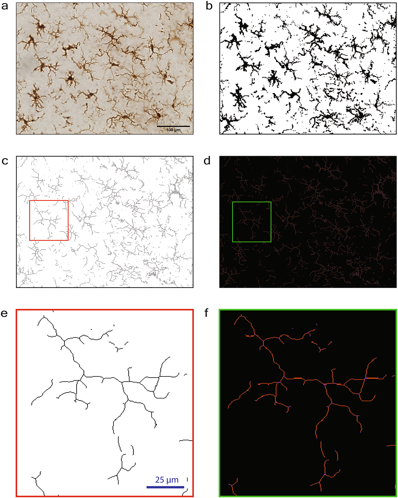
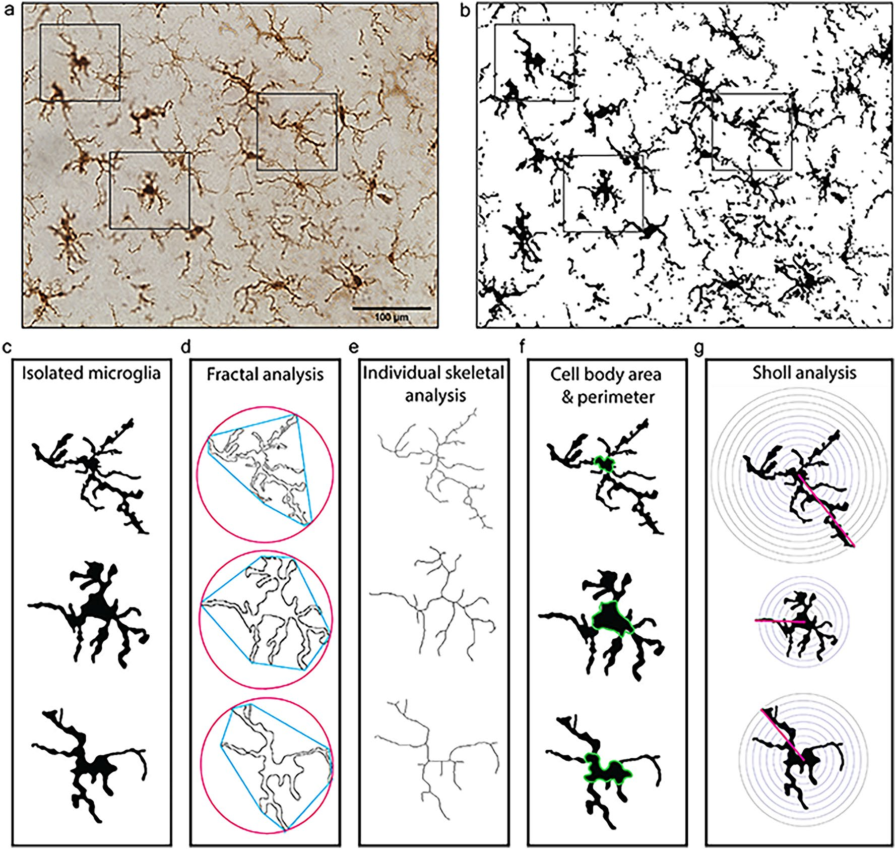
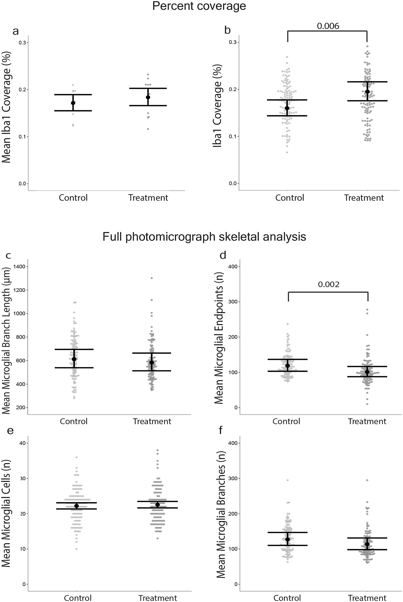
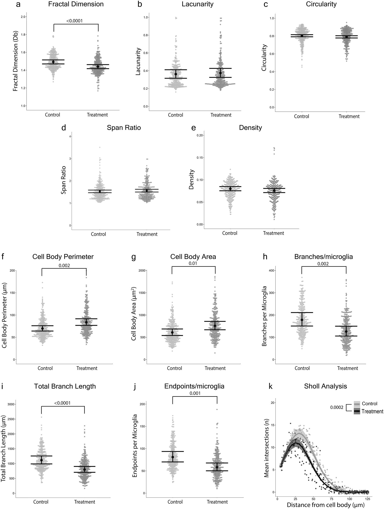
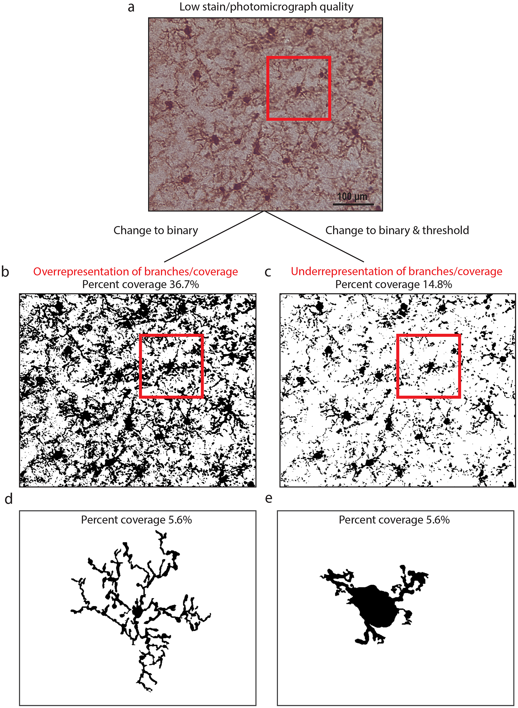

# Figures — Green, Murphy & Rowe 2022 (Sci Rep 12:18196)

The figures are reproduced under the article's **CC BY 4.0** licence: © The Author(s) 2022,
https://doi.org/10.1038/s41598-022-23091-2. They were extracted unchanged from the PDF and
converted to PNG. The only image dropped is a text glyph ("Published online: 28 October 2022").

All photomicrographs are **brightfield DAB** Iba1 immunohistochemistry (brown on a grey-beige
background), from **mouse cortex** (retrosplenial, somatosensory or entorhinal; the figures do
not say which), in **40 µm** sections imaged with a **40× objective**. Our data is different:
fluorescent Iba1/CD68, 20× objective, hippocampus. In the DAB images, cells are **dark on
light**, where ours are bright on dark. Scale bars were measured on these extracted PNGs; see the
digest §7 for the caveat on absolute scale.

---

## Fig 1 — whole-image skeleton pipeline

- **(a)** A 40× Iba1 DAB field. The 100 µm bar is 147 px, so ≈ 0.68 µm per figure-px and the
  field is ≈ 538 × 399 µm.
  - **About two dozen somata** are visible, in line with the paper's mean of ≈ 22 per image.
    They are spaced fairly evenly, roughly one cell-span apart, with no clumping.
  - Each cell shows a **dark, compact soma** and about **4–8 thick primary processes**. These
    taper into finer, beaded, sinuous branches.
  - The **soma is not circular.** It merges smoothly into the thick proximal trunks, so where
    the soma ends is a judgement call. This is the "first Sholl ring" problem.
  - A cell's arbor reaches roughly 50–80 µm across at this scale.
  - **Neighbouring arbors touch and interdigitate at their tips.** No cell's processes clearly
    overlap a neighbour's soma, but the outer branches of adjacent cells often meet. In 2D you
    cannot tell which cell owns them.
  - There are many **faint, thin process fragments** with no visible parent soma. They are
    probably out of focus or come from cells in other planes of the 40 µm section.
  - The somata differ in darkness: some cells are crisp, others blurred or out of focus.
  - The background is uneven, with a darker grey patch at the left.
- **(b)** The same field after thresholding (black = Iba1+). The somata and thick trunks survive
  as solid blobs. The fine branches break into **many disconnected specks and short segments**.
  Arbors next to each other merge into continuous dark clusters (top right, centre). Scattered
  background specks are visible everywhere.
- **(c)** The skeleton of (b). Each cell becomes a tree, but there are **many isolated short
  fragments**, and the dense regions turn into **small looped meshes**. These come from
  skeletonising blobs, for example near the right edge and at the bottom right. The red box
  marks the region enlarged in (e).
- **(d)** The same skeleton tagged by Analyze Skeleton (on black: branches orange, junctions
  purple, endpoints blue-ish). It is too small at this size to read individual tags. The green
  box marks (f).
- **(e)** A 4.6× enlargement of the red box, about 118 µm wide. The 25 µm bar is 167 px, which
  agrees with (a)'s scale within 1 %.
  - One cell's skeleton has about **5 main limbs** from a central junction cluster, with
    secondary and tertiary branches.
  - It contains a **small loop** (right of centre).
  - There are **about 8–10 detached segments** near its tips: broken process pieces that the
    whole-image analysis counts as extra branches and endpoints.
- **(f)** The same region, tagged. Junction points are purple, branches orange, endpoints at the
  tips. **Thick orange runs** mark places where the skeleton is two pixels wide.

**For our algorithm:** even in a clean 40× field, thresholding breaks every cell's fine arbor
into pieces and fuses neighbouring arbors. Assigning fragments to cells is the core problem. At
20×, with fluorescent Iba1, the fine branches will be thinner still.

---

## Fig 2 — single-cell methods

- **(a)** Another 40× DAB field (lower JPEG quality). The 100 µm bar is 135 px (≈ 0.74 µm per
  figure-px; field ≈ 670 × 550 µm). Three **black squares** mark the randomly selected cells.
  The density and look of the cells match Fig 1a: about 20+ somata, ramified, with neighbouring
  arbors meeting.
  - The **top-left box contains two cells**: the selected one and a second soma at its lower
    left.
  - The box size was fixed for the whole study, about 95 µm at this scale. That box always
    **includes branches of neighbours**, which the authors removed by hand.
- **(b)** Binary version with the same boxes. Lots of speckle. The selected cells' arbors run
  into neighbours' fragments.
- **(c) Isolated microglia.** Three hand-cleaned binary cells:
  1. Top: a sprawling cell with long, beaded processes, mostly in one diagonal direction.
  2. Middle: a large dark central body with about 7–8 thick, short processes.
  3. Bottom: a cell with about 5 processes and an irregular body.

  The processes are **thick and blobby** in the binary image. These masks are what all the
  single-cell numbers were measured on.
- **(d) Fractal analysis.** Each cell's outline (grey double line) inside its **convex hull**
  (blue polygon) and **bounding circle** (magenta). The hull is a 4–6-sided polygon spanning the
  arbor.
- **(e) Individual skeleton analysis.** A thin skeleton of each cell, with about 5–7 main limbs
  and many short side branches. The **number of branches is much higher than the number of
  visible processes.**
- **(f) Cell body area & perimeter.** Hand-drawn green outlines around the soma. The outline
  takes in the **thick proximal trunks**, especially in the middle and bottom cells. This
  explains the large reported soma areas (≈ 600–750 µm²). The middle cell's outline covers most
  of its dark central mass.
- **(g) Sholl analysis.** Concentric circles (grey/lavender) centred on the soma, with a magenta
  radius drawn to the tip of the longest branch. The top cell has about 14 visible rings, the
  middle about 7, the bottom about 9. The **inner rings fall inside the irregular soma or cross
  the thick trunks**, which is the placement problem the authors describe.

No scale bar is drawn for (c)–(g). The caption applies the 100 µm bar to (a, b) only.

---

## Fig 3 — whole-image results

Each panel shows the model point estimate (black dot) with its 95 % CI (black bars) for Control
and Treatment, over grey dots for individual images or mice. Values read off the plots are in the
digest §5a.

- **(a)** Mean Iba1 coverage per mouse. About 0.17 vs 0.18; no bracket, n.s.
- **(b)** Coverage per image. About 0.16 vs 0.195; bracket "0.006". Raw values ≈ 0.07–0.29.
  The y-axis is labelled "(%)" but the scale is a fraction.
- **(c)** Mean microglial branch length (µm), about 610 vs 580, n.s. Per image ≈ 280–1300.
- **(d)** Mean endpoints per cell, about 119 vs 101; bracket "0.002".
- **(e)** Mean microglial cells per image, about 22 vs 22.5, n.s. **Integer counts from 10 to
  38** per 40× field. This is the paper's only cell-density information.
- **(f)** Mean branches per cell, about 127 vs 114, n.s. (p = 0.08).

---

## Fig 4 — single-cell results

Same layout as Fig 3, with dots for individual cells (n = 345 / 324).

- **(a)** Fractal dimension, about 1.49 vs 1.44; "<0.0001".
- **(b)** Lacunarity, about 0.36 vs 0.375, n.s. The distribution is skewed and floors near 0.2.
- **(c)** Circularity, about 0.80 vs 0.79, n.s. Values sit high (0.45–0.95), consistent with a
  hull-based measure rather than mask circularity.
- **(d)** Span ratio, about 1.53 vs 1.56, n.s. Range ≈ 1.0–3.5.
- **(e)** Density, about 0.080 vs 0.076, n.s. Range ≈ 0.01–0.17.
- **(f)** Cell body perimeter (µm), about 70 vs 84; "0.002".
- **(g)** Cell body area (µm²), about 610 vs 760; "0.01". Cells range ≈ 150–1870.
- **(h)** Branches per microglia, about 179 vs 127; "0.002". Range ≈ 20–370.
- **(i)** Total branch length (µm), about 1110 vs 800; "<0.0001". Range ≈ 160–2570.
- **(j)** Endpoints per microglia, about 81 vs 58; "0.001". Range ≈ 9–188.
- **(k)** Sholl: mean intersections against distance from the cell body (0–125 µm). Light grey =
  Control, dark = Treatment, with a fitted spline and band, and dots per mouse and distance.
  - Control peaks at about 13–14 near 30 µm; Treatment at about 11 near 25 µm.
  - Both reach about 0 by 90–100 µm.
  - The legend bracket says **"0.0002"**, but the text says p = 0.002.

---

## Fig 5 — how processing changes the result

- **(a) "Low stain/photomicrograph quality."** A darker, purplish-brown DAB field. The 100 µm
  bar is 140 px (≈ 0.71 µm per figure-px; field ≈ 573 µm wide).
  - About 25–30 **dark round somata** stand out clearly.
  - The processes are faint and low-contrast against a **mottled, textured background** of
    similar hue.
  - The red box marks a region shown again in (b) and (c).

  This is the image type where a soma detector would still work but process tracing would not.
- **(b) "Change to binary" → "Overrepresentation of branches/coverage", 36.7 %.** The background
  texture binarises into a dense black network. The cells are lost inside it.
- **(c) "Change to binary & threshold" → "Underrepresentation of branches/coverage", 14.8 %.**
  The somata survive as blobs, but most processes are gone, leaving short stubs and specks. The
  cells look **amoeboid/reactive** purely because of the threshold.
- **(d)** An isolated, highly ramified cell (binary). Small soma, about 6–8 long, beaded,
  branching processes. **5.6 % coverage.**
- **(e)** An isolated reactive-looking cell. A large, solid, rounded body with about 4–5 short,
  stubby processes. **Also 5.6 % coverage.**

  (d) and (e) show that coverage cannot tell a ramified cell from a reactive one. Together they
  are a compact visual reference for the two ends of the morphology continuum.
