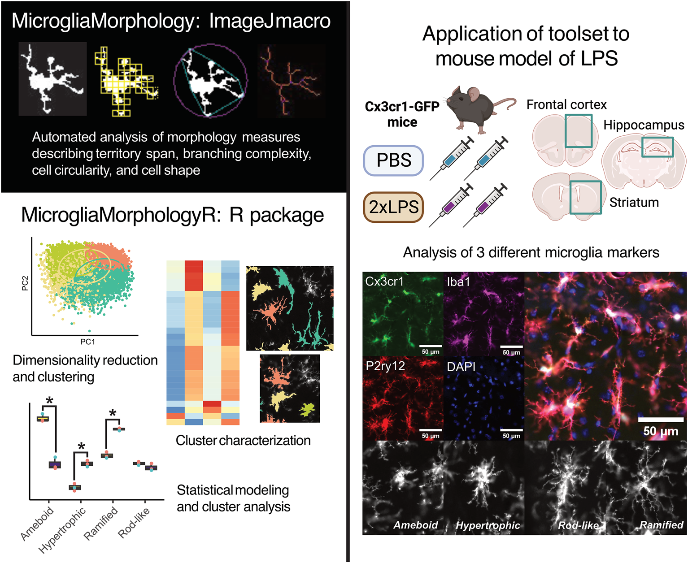
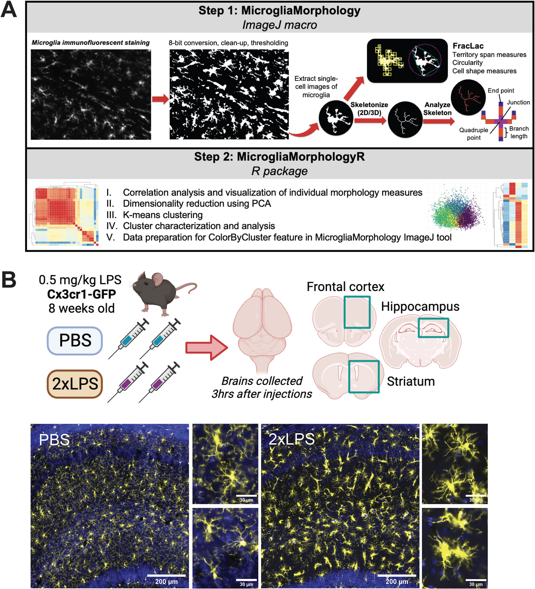
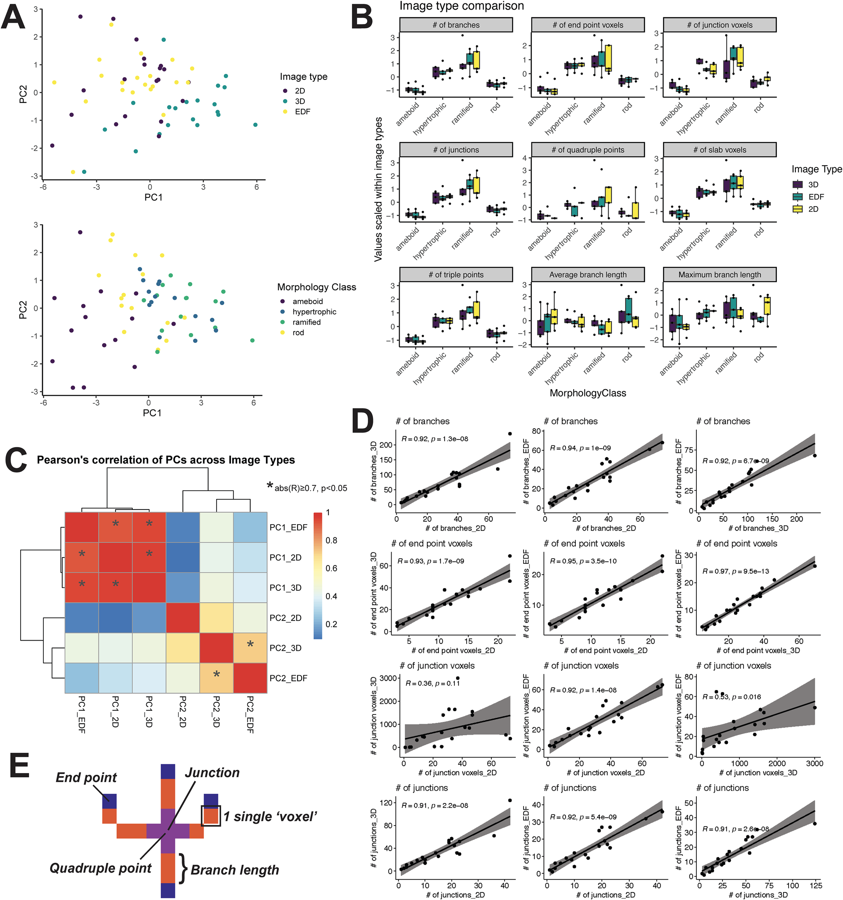
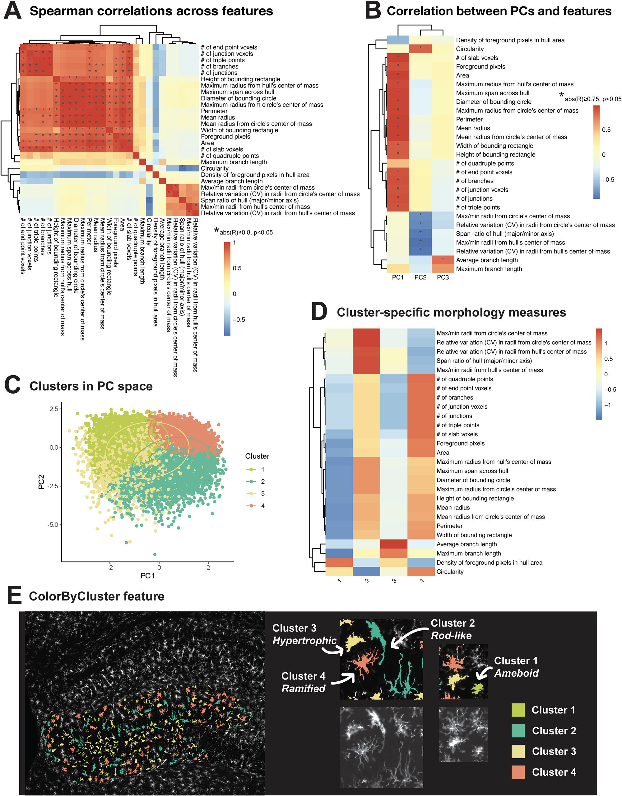
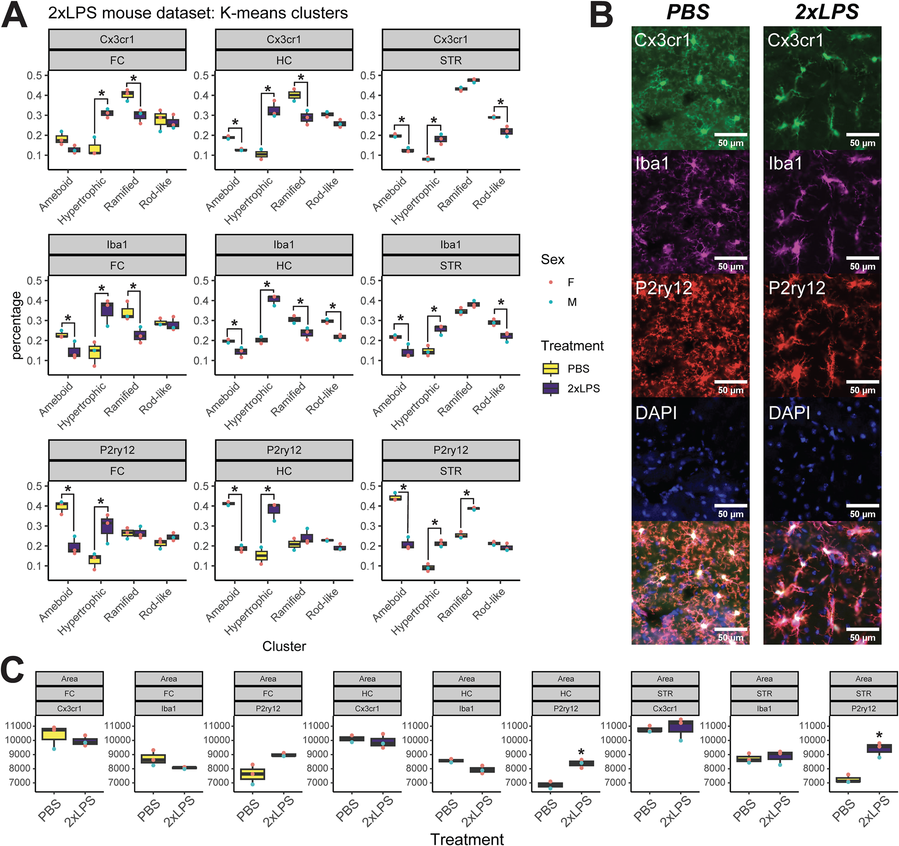

# Figures — Kim, Pavlidis & Vogel Ciernia 2024

Every raster embedded in
[`../kim-2024-microglia-morphology-pipeline.pdf`](../kim-2024-microglia-morphology-pipeline.pdf),
converted to PNG unchanged (CC BY 4.0, © 2024 Kim et al.). Each figure is one embedded image; there
are five, all real figures. Paper digest: [`../digest.md`](../digest.md).

Scale measured off the figures by me (white-bar pixel run in the embedded image): Fig 1B overview
**200 µm = 143–144 px** (≈ 1.40 µm/px of this figure image; the 600-px-wide overview spans ≈ 840
µm); Fig 1B insets **30 µm = 77 px** (≈ 0.39 µm/px). These are figure-image scales, **not** the
acquisition pixel size, which the paper never states.

---

## Visual abstract — `fig0_visual_abstract.png` (1534 × 1256)

- **Top left (black):** "MicrogliaMorphology: ImageJ macro" — four icons of one cell: binary
  mask, FracLac box-count grid (yellow), convex hull (teal) inside bounding circle (purple), and
  the tagged skeleton (orange slabs, purple junctions). Caption: territory span, branching
  complexity, cell circularity, cell shape.
- **Bottom left:** "MicrogliaMorphologyR" — PC1/PC2 scatter with 4 cluster colours, cluster ×
  feature heatmap, ColorByCluster crops (cells painted orange/teal/yellow/green), and a
  boxplot of Ameboid/Hypertrophic/Ramified/Rod-like shares with stars.
- **Right:** design (Cx3cr1-GFP mice, PBS vs 2xLPS; frontal cortex, hippocampus, striatum boxes
  on coronal outlines); "Analysis of 3 different microglia markers": the same field in
  **Cx3cr1** (green), **Iba1** (magenta), **P2ry12** (red), **DAPI** (blue), each with a **50 µm**
  bar, plus a larger merge (50 µm bar); bottom strip: four grayscale exemplar cells labelled
  **Ameboid, Hypertrophic, Rod-like, Ramified** (no bar).

**What I see:** in the 50 µm single-marker tiles, roughly 6–10 cells per tile with clear somata
and 4–8 primary processes each; processes from neighbouring cells interdigitate at the tile
scale. The Iba1 tile shows bright somata and thinner, dimmer processes than P2ry12, whose signal
is spread along the branches. The exemplars: "ameboid" here is still a cell with several short
processes (not a round blob); "hypertrophic" has a big bright soma with thick short processes;
"rod-like" is elongated with processes along one axis; "ramified" has a small soma and long,
fine, highly branched processes. The "ameboid" exemplar is the one an algorithm could most
easily confuse with a hypertrophic cell.

---

## Figure 1 — `fig1_study_overview.png` (2000 × 2200)

Caption: "Study overview. A, Outline of steps involved in MicrogliaMorphology and
MicrogliaMorphologyR. B, Experimental mouse model ... Example images from the dorsal hippocampus
with individual microglia insets for each treatment condition. Microglia (Iba1) in yellow and DAPI
nuclear stain in blue. Full size images scale bar 200 µm, insets 30 µm."

- **A, Step 1 (ImageJ macro):** "Microglia immunofluorescent staining" (grayscale field, dozens
  of cells) → "8-bit conversion, clean-up, thresholding" (binary: white blobs with stubby
  processes, many touching) → "Extract single-cell images of microglia" → two branches: **FracLac**
  (box grid, hull + circle: "Territory span measures, Circularity, Cell shape measures") and
  **Skeletonize (2D/3D) → Analyze Skeleton** (tagged skeleton plus glossary: End point,
  Junction, Quadruple point, Branch length).
  **Step 2 (R package):** I. correlation analysis and visualization of individual measures;
  II. dimensionality reduction using PCA; III. K-means clustering; IV. cluster characterization and
  analysis; V. data preparation for ColorByCluster.
- **B, design:** 0.5 mg/kg LPS, Cx3cr1-GFP, 8 weeks old; PBS vs 2xLPS; "Brains collected 3hrs
  after injections"; frontal cortex / hippocampus / striatum boxes. **Images:** PBS overview
  (200 µm bar) + two insets (30 µm), 2xLPS overview (200 µm) + two insets (30 µm). Yellow =
  Iba1 (per caption), blue = DAPI.

**What I see — the most useful panel for us (same species, region, marker and magnification
class as ours):**
- *Binary in A:* the thresholded field is a carpet of blobs, many fused into multi-cell clumps
  and many fragments — exactly the problem the area window is there to throw away.
- *PBS overview (dorsal hippocampus, ≈ 840 µm wide):* several hundred evenly tiled yellow cells;
  somata are separated by roughly 2–4 soma diameters with **no visible empty gaps** between
  territories — the processes of neighbours fill the space between somata, so at this scale the
  field reads as a continuous mesh with bright dots. The dense DAPI band of the granule/pyramidal
  cell layer crosses the bottom and top edges; microglia are present inside it too but sparser.
- *PBS insets (30 µm bar):* a ramified cell spans roughly 50–60 µm tip to tip (about twice the
  bar); 5–8 primary processes leave a small (~8–10 µm) soma and branch 2–3 more times; the finest
  terminal branches are 1–2 px wide in the figure and fade into background haze. **Processes of
  neighbouring cells visibly meet and cross** — two cells per inset is typical, plus fragments of
  others entering from the edges. Out-of-focus haze from the EDF is visible around cells.
- *2xLPS overview and insets:* brighter, thicker cells with larger somata and shorter, thicker
  processes; several elongated cells aligned roughly perpendicular to the cell layer (rod-like).
  Overlap between neighbours is worse than in PBS.

---

## Figure 2 — `fig2_image_type_comparison.png` (2000 × 2134)

Comparison of **3D vs EDF vs single-plane 2D** for 20 hippocampal cells (5 per class).

- **A:** two PC1–PC2 scatters of the 60 points (20 cells × 3 image types), coloured by **image
  type** (2D purple, 3D teal, EDF yellow) and by **morphology class**. 3D points sit at higher
  PC1 than 2D/EDF; ameboid cells sit at low PC1.
- **B:** box plots of 9 skeleton measures (# branches, # end point voxels, # junction voxels,
  # junctions, # quadruple points, # slab voxels, # triple points, average branch length, maximum
  branch length), z-scored *within* image type, by class (ameboid, hypertrophic, ramified, rod) and
  image type. The class ordering (ameboid lowest, ramified highest, hypertrophic second, rod
  low-middle) is the same in all three image types for the count measures; branch-length
  measures are noisy and do not separate classes cleanly.
- **C:** heatmap of correlations among PC1/PC2 of each image type; stars (|R| ≥ 0.7, p < 0.05)
  on all PC1 pairs and on PC2_3D–PC2_EDF only. Panel title says **Pearson**, caption says
  **Spearman**.
- **D:** 12 scatter plots with regression line and CI — # branches, # end point voxels,
  # junction voxels, # junctions, each 3D-vs-2D, EDF-vs-2D, EDF-vs-3D. R and p transcribed in
  [`../digest.md`](../digest.md) §4.1. Axis ranges show 3D counts ~3× the 2D/EDF counts.
- **E:** skeleton glossary drawing: blue end points, orange slab pixels, purple junction
  ("quadruple point" where four arms meet), a boxed "1 single 'voxel'", and a bracket for
  "Branch length".

---

## Figure 3 — `fig3_morphology_clusters.png` (2000 × 2556)

2xLPS dataset (43,332 cells).

- **A — "Spearman correlations across features":** clustered 27 × 27 matrix, stars at |R| ≥ 0.8,
  p < 0.05. A large red block covers the 5 complexity counts + 12 territory/area measures (incl.
  # slab voxels); a small separate red block holds the five shape/oblongness measures; branch
  lengths, circularity, density-in-hull and quadruple points are loosely attached. Circularity
  vs span ratio is strongly negative (blue, starred).
- **B — "Correlation between PCs and features":** 27 × 3 heatmap, stars at |R| ≥ 0.75. PC1: red
  and starred for the complexity and territory features. PC2: red for circularity, blue
  (starred) for the five shape measures. PC3: red (starred) for average branch length, orange for
  maximum branch length. **Density of foreground pixels in hull area** is **blue on PC1** in the
  heatmap, while the text says PC1 is "highly positively correlated" to it — an inconsistency (a
  sign convention, or a text error) that I cannot resolve from the PDF.
- **C — "Clusters in PC space":** PC1 (≈ −3.5…2.5) × PC2 (≈ −7…2.5); cluster 1 (green, upper
  left), 2 (teal, lower), 3 (pale yellow, spread left/centre, overlapping 1 and 2), 4 (orange,
  upper right); ellipses per cluster.
- **D — "Cluster-specific morphology measures":** features × clusters 1–4, scaled. Cluster 1
  blue on almost everything except density-in-hull (red) and circularity; cluster 2 red on the
  five shape measures and blue on circularity; cluster 3 red on average and maximum branch
  length; cluster 4 red on all complexity counts and orange on territory and circularity. By the
  heatmap colours, **density-in-hull is highest for cluster 1 (ameboid)**, not cluster 3 as the
  text says ("Cluster 3 had the highest branch lengths and density of foreground pixels in the
  hull") — another text/figure discrepancy.
- **E — ColorByCluster:** grayscale hippocampal section (Iba1/marker not stated; no scale bar)
  with cells inside a traced subregion ROI painted by cluster; zoom crops labelled **Cluster 3
  Hypertrophic, Cluster 2 Rod-like, Cluster 4 Ramified, Cluster 1 Ameboid**, each above its
  grayscale original.

**What I see in E:** outside the ROI, hundreds of small, evenly tiled white star-shaped cells —
the density of the PBS overview of Fig 1B. Inside the ROI, painted cells are spaced so that they
rarely touch, and **some cells inside the ROI stay unpainted** (those that failed the area window
or fused with a neighbour). The rod-like (teal) cells are elongated and several are aligned along
the same direction; in the zoom, one teal "cell" is a long chain that looks like two or more
aligned cells fused — a hint that some rod-like calls are merged neighbours. The painted shapes
are the thresholded masks, visibly blobbier than the grayscale processes beneath them (fine
terminal branches lost).

---

## Figure 4 — `fig4_lps_cluster_shifts.png` (2000 × 1882)

- **A — "2xLPS mouse dataset: K-means clusters":** 3 × 3 grid (rows Cx3cr1 / Iba1 / P2ry12; columns
  FC / HC / STR) of box plots, y = fraction of cells (0.1–0.5) per cluster (Ameboid, Hypertrophic,
  Ramified, Rod-like), PBS (yellow) vs 2xLPS (purple), dots coloured by sex (F red, M teal), stars =
  Bonferroni p < 0.05. Hippocampus values transcribed in [`../digest.md`](../digest.md) §4.4.
- **B:** the same field in PBS and 2xLPS, rows **Cx3cr1** (green), **Iba1** (magenta), **P2ry12**
  (red), **DAPI**, merge; every tile has a **50 µm** bar.
- **C:** box plots of **"Area"** (axis 7,000–11,000, **no unit**), PBS vs 2xLPS, for each region ×
  marker; stars only for HC-P2ry12 and STR-P2ry12.

**What I see in B (Iba1 row):** each tile (263 px wide, 50 µm bar = 72 px, so ≈ 180 µm
across) holds roughly 8–12 cells with a visible soma. In
PBS, small bright somata with thin branching processes; in 2xLPS, larger brighter somata, thicker
processes, several elongated cells oriented the same way. Iba1 labels the soma most strongly;
P2ry12 marks a dense lacework of fine processes that fills almost the whole tile in PBS, making
individual cells far harder to separate than in Iba1. Cx3cr1-GFP shows the most diffuse
background haze.
