# Figures — Lind-Holm Mogensen et al. 2024 (STAR Protocols 5:103467)

Every image embedded in
[`../lind-holm-mogensen-2024-microglia-morphology-protocol.pdf`](../lind-holm-mogensen-2024-microglia-morphology-protocol.pdf),
extracted at native resolution and converted to PNG. Paper digest: [`../digest.md`](../digest.md).
Licence **CC BY 4.0** (stated on p. 1 of the PDF); © the authors, schematics made with BioRender.

The paper has **no numbered figures and no captions** — images sit inline beside the step they
illustrate. Numbering below is page order. Nothing was dropped: the only non-content image is the
cover's graphical abstract, kept because it carries the only 3D render of a segmented cell.

**Scale bars on the micrographs** were measured off these extracted images (bar length in pixels
of the PNG, ±1–2 px). They describe the *printed* image, not the acquisition sampling (0.221
µm/px), and are given only to judge what is visible.

| Fig | Bar | Bar length (px) | ≈ µm/px of this PNG | ≈ field width |
|---|---|---|---|---|
| 18 | 50 µm | 100 | 0.50 | ≈ 490 µm |
| 19 | 50 µm | 50 | 1.0 | ≈ 970 µm |
| 20 | 50 µm | 146 | 0.34 | ≈ 330 µm |
| 21 | 100 µm | 94 | 1.06 | ≈ 1,030 µm |
| 22 | 100 µm | 93 | 1.08 | ≈ 1,050 µm |

Figs 21–22 come out at ≈ 1,030–1,050 µm across — consistent with the stated 1020.23 µm full
3×3-tile acquisition, so those two are whole acquisitions (rendered with the Imaris frame grid).

---

## fig01 — `fig01_workflow_overview.png` (1325 × 1325), cover / graphical abstract

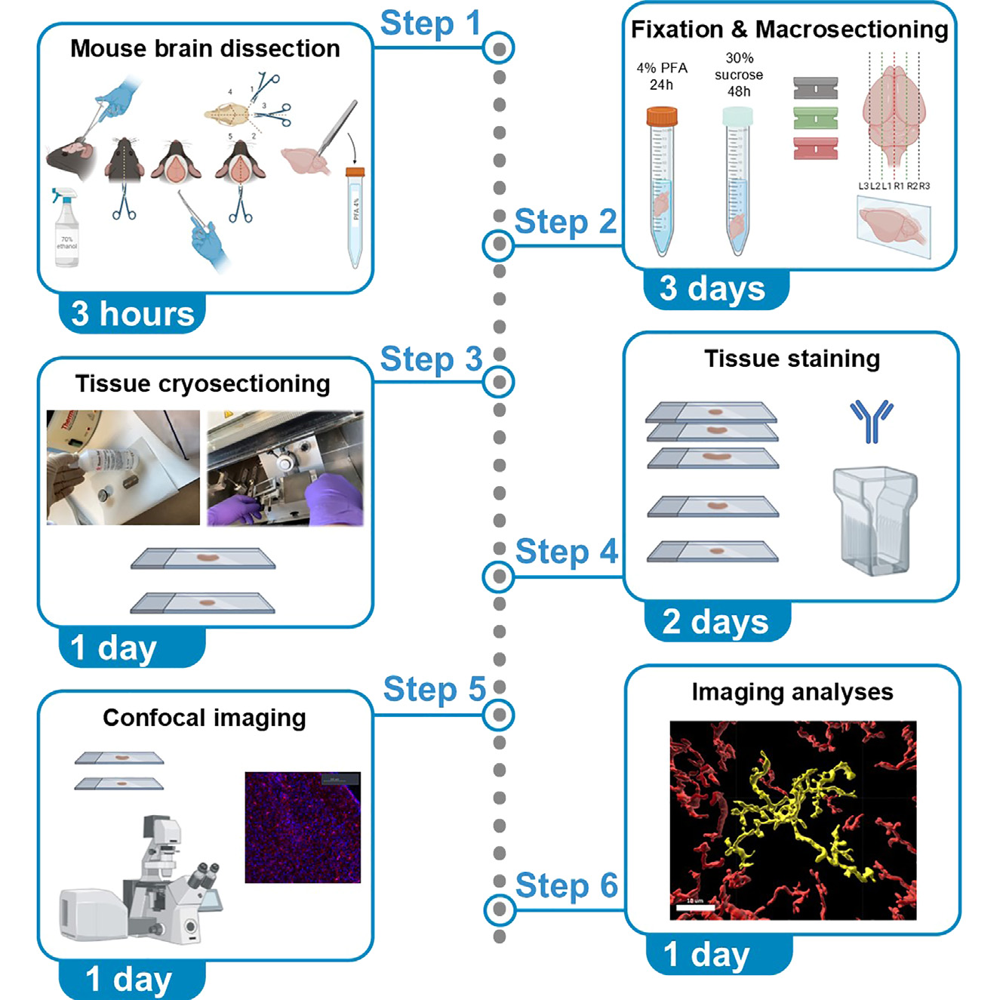

Six-step timeline: **Step 1** mouse brain dissection (3 hours); **Step 2** fixation &
macrosectioning — 4% PFA 24 h, 30% sucrose 48 h, three coloured blades, sagittal cut lines
L3 L2 L1 R1 R2 R3 (3 days); **Step 3** tissue cryosectioning, two photos + slides (1 day);
**Step 4** tissue staining, slides + antibody + Coplin jar (2 days); **Step 5** confocal imaging,
microscope + a small purple/blue overview thumbnail (1 day); **Step 6** imaging analyses (1 day).

**What we see in Step 6:** an Imaris 3D surface render on black — one cell highlighted **yellow**
in the centre, neighbouring cell surfaces in **red**. Scale bar "10 µm" (text barely legible).
The yellow cell is a typical ramified (homeostatic) microglia: small soma, many thin, tortuous,
beaded processes radiating ≈ 2–3 bar-lengths in each direction. The red neighbours are mostly
**fragments of processes** — short disconnected tubes — which is exactly what the voxel filter
later throws away. Processes of neighbours come close to the yellow cell but do not visibly fuse
with it in this render.

## fig02 — `fig02_dissection_bench.png` (972 × 1296), p. 6

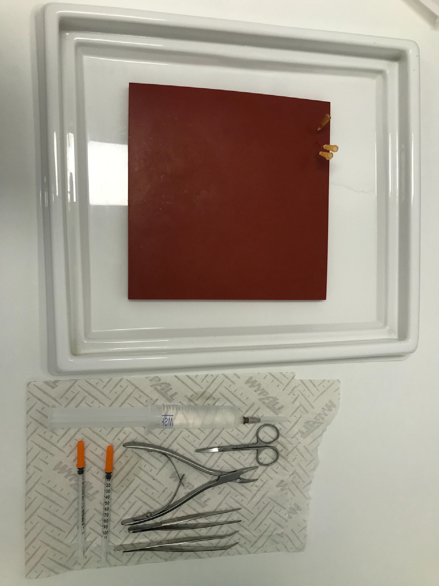

Photo: white drip tray with a red rubber board and pins; below, on tissue paper, a syringe,
two insulin syringes, small scissors, bone trimmer (rongeur-like cutter) and two forceps. Bench
layout for step 2 — no analysis content.

## fig03 — `fig03_brain_dissection_cuts.png` (972 × 622), p. 6

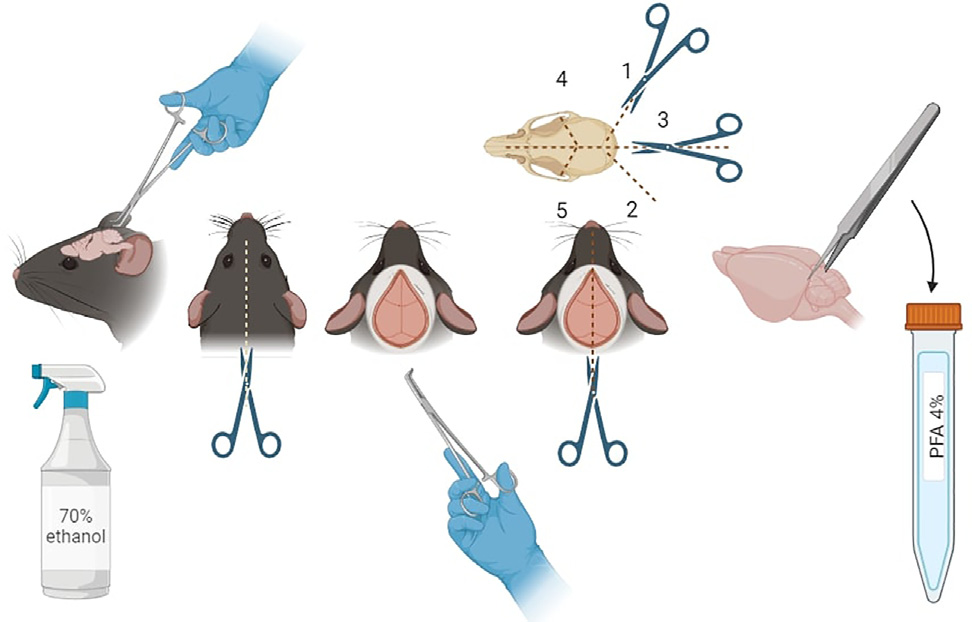

BioRender schematic of dissection: 70% ethanol spray; scalp midline cut; skull exposed; skull
diagram with numbered cuts **1** and **2** (along intraparietal bone, right then left), **3**
(midline to frontal/nasal bone), **4** and **5** (between parietal and frontal bones toward the
eye sockets); brain lifted out with forceps; dropped into a **PFA 4%** Falcon tube.

## fig04 — `fig04_brain_matrix_macrosections.png` (972 × 744), p. 8

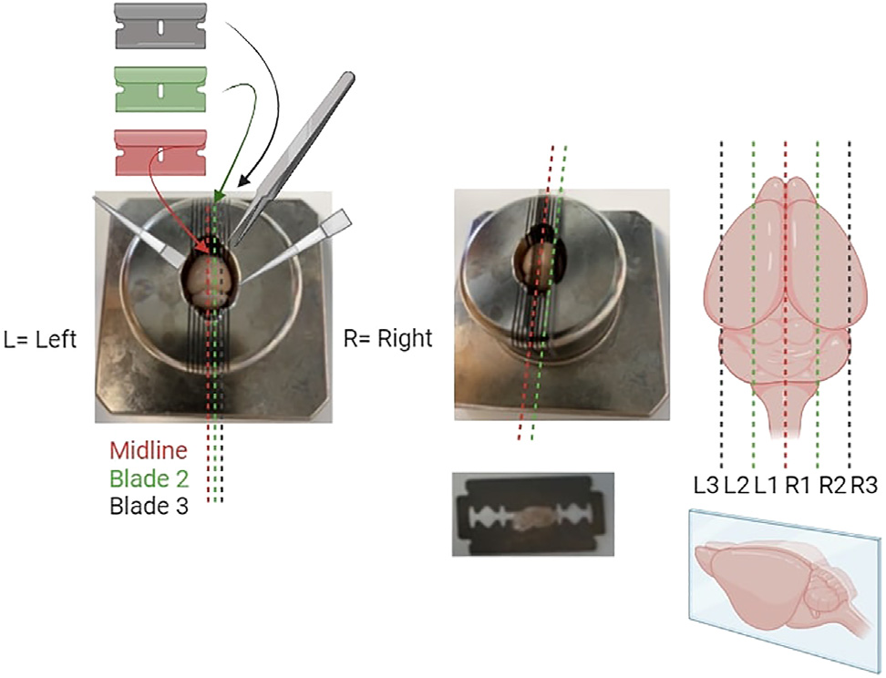

Left: photo of the brain in the rodent brain matrix with forceps and pipette tips holding it,
three blade colours mapped to **Midline (red)**, **Blade 2 (green)**, **Blade 3 (black)**, labels
"L = Left", "R = Right". Centre: matrix with blades inserted; a blade with tissue on it. Right:
dorsal brain schematic with six **sagittal** cut lines **L3 L2 L1 R1 R2 R3** and a sagittal
slab on glass. **So sections are sagittal**, not coronal — relevant if we compare hippocampal
appearance with the owner's slices.

## fig05 — `fig05_cryostat_oct.png` (972 × 729), p. 9

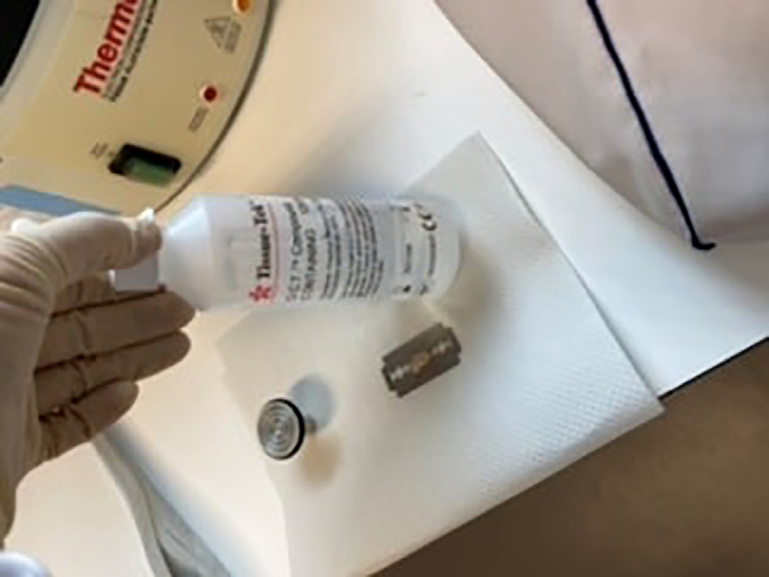

Photo: gloved hand applying Tissue-Tek OCT from a bottle onto a specimen chuck next to a blade,
in front of a cryostat (Thermo branding visible on the instrument). Step 15.

## fig06 — `fig06_cryostat_chuck.png` (972 × 729), p. 9

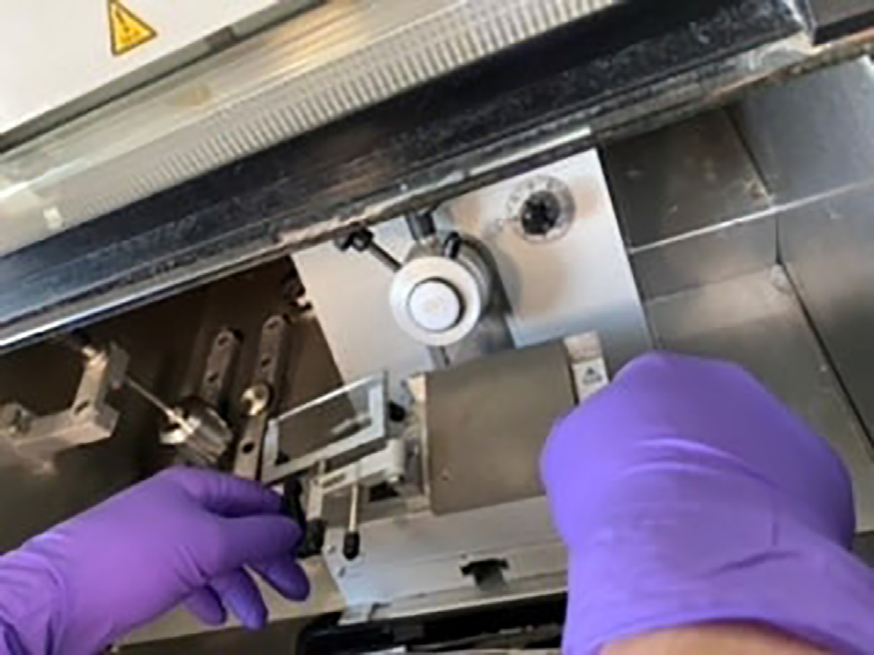

Photo: inside the cryostat — chuck mounted in the holder, blade holder and anti-roll plate,
gloved hands. Steps 16–18.

## fig07 — `fig07_imaris_normalize_gaussian.png` (797 × 824), p. 12

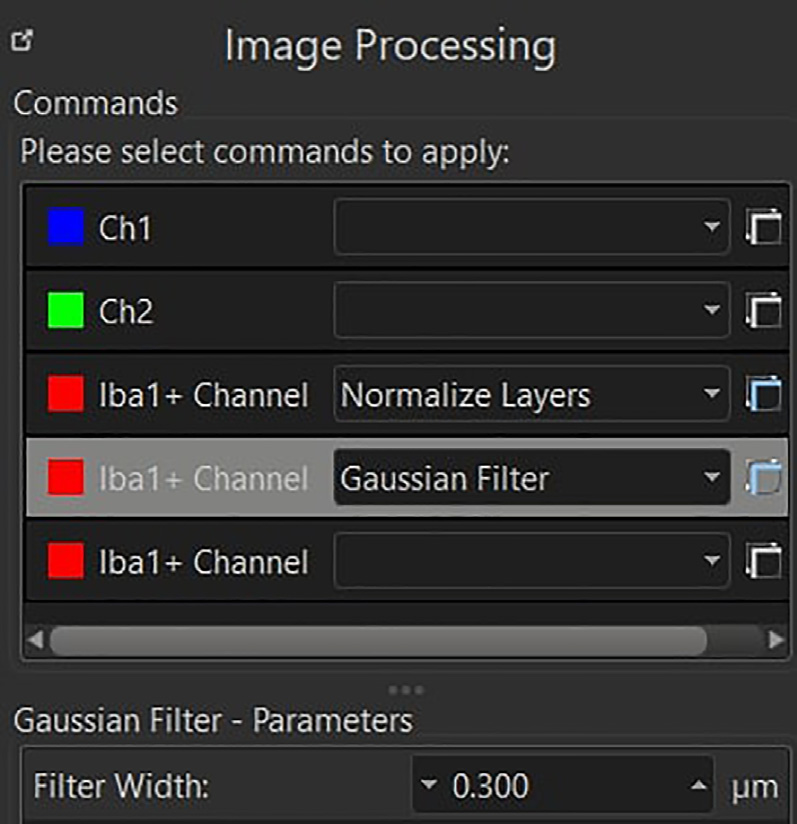

Imaris *Image Processing* panel: channels **Ch1 (blue)**, **Ch2 (green)**, **Iba1+ Channel
(red)**. Commands queued on Iba1: **Normalize Layers**, then **Gaussian Filter**. Gaussian
parameters: **Filter Width 0.300 µm**. (Confirms the step-45 text "width = 0.3" is in µm.)

## fig08 — `fig08_imaris_surfaces_button.png` (797 × 294), p. 13

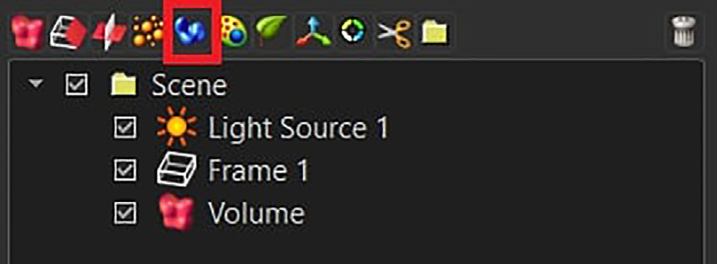

Imaris Surpass toolbar with the **Surfaces** creation icon boxed in red; scene tree shows Light
Source 1, Frame 1, Volume.

## fig09 — `fig09_imaris_surfaces_step1.png` (797 × 946), p. 13

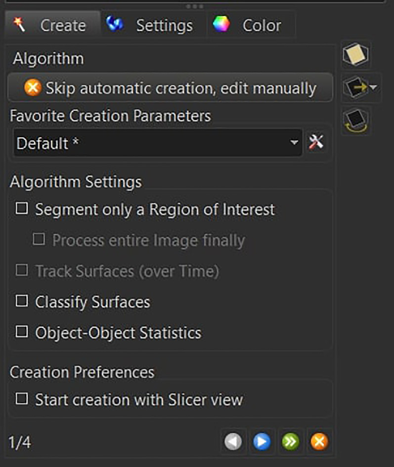

Surfaces wizard **1/4**, Favorite parameters "Default \*". All unchecked: Segment only a Region of
Interest, Process entire Image finally (greyed), Track Surfaces (greyed), **Classify Surfaces**,
**Object-Object Statistics**, Start creation with Slicer view.

## fig10 — `fig10_imaris_surfaces_step2_smooth_localcontrast.png` (797 × 957), p. 14

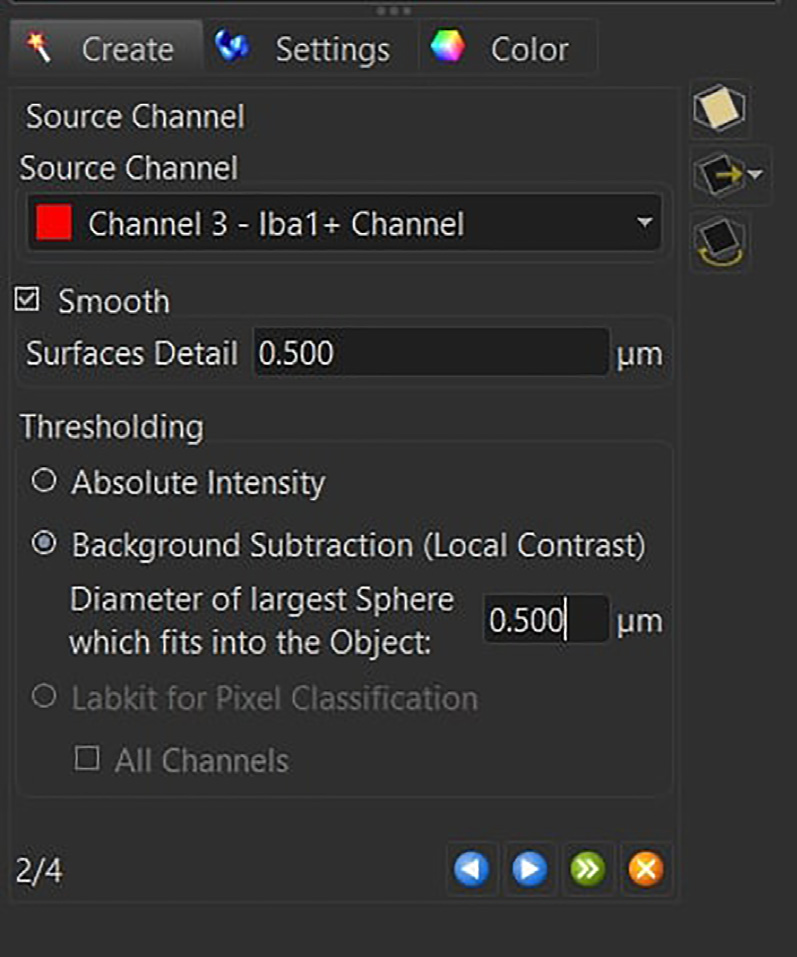

Wizard **2/4**. Source Channel **"Channel 3 - Iba1+ Channel"**. **Smooth ✓, Surfaces Detail
0.500 µm.** Thresholding: Absolute Intensity ○, **Background Subtraction (Local Contrast) ●**,
**Diameter of largest Sphere which fits into the Object: 0.500 µm**; Labkit for Pixel
Classification (greyed). (Note the Imaris label: the local-contrast diameter is meant as the
*largest sphere fitting in the object* — i.e. the expected thickness of the thinnest structures
to keep, here processes.)

## fig11 — `fig11_imaris_surfaces_step3_threshold.png` (797 × 1040), p. 14

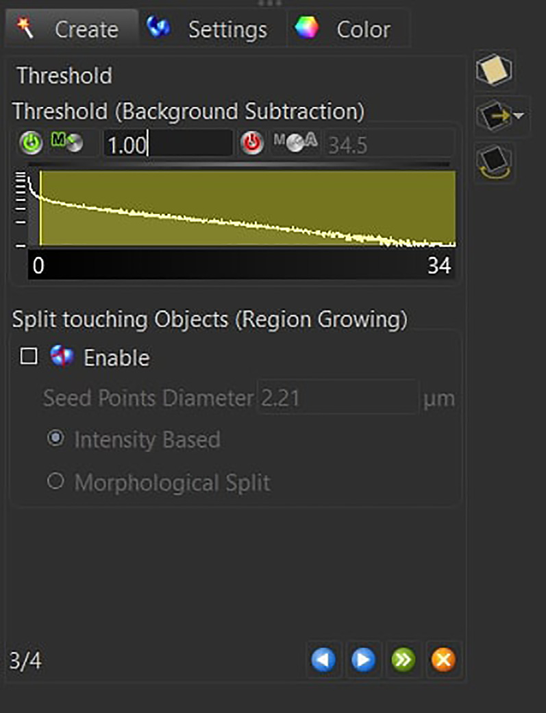

Wizard **3/4**. **Threshold (Background Subtraction) = 1.00** (lower bound, enabled); upper bound
disabled, greyed value **34.5**. Histogram axis 0 to 34, monotonically decreasing, everything
right of the yellow line at 1.00 selected — i.e. most of the local-contrast range is kept and the
cut sits just above the background peak. **Split touching Objects (Region Growing): Enable ☐**
(off); greyed defaults Seed Points Diameter **2.21 µm**, Intensity Based.

## fig12 — `fig12_imaris_surfaces_step4_voxel_filter.png` (797 × 1164), p. 15

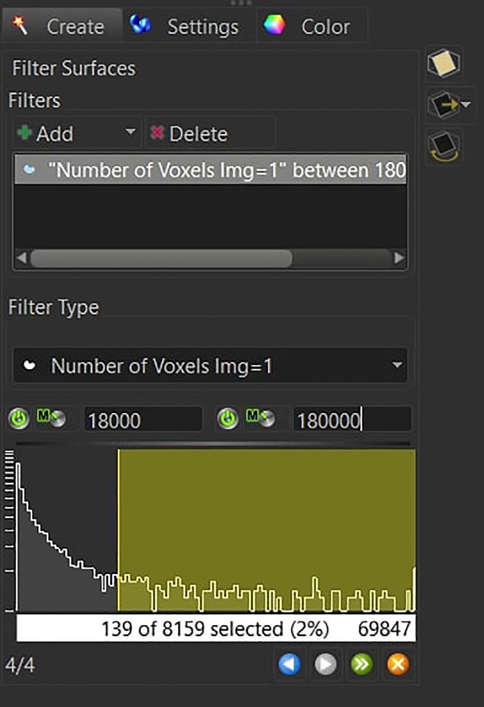

Wizard **4/4**, Filter Surfaces: filter **"Number of Voxels Img=1" between 18000 and 180000**.
Histogram of object sizes: a tall peak of small objects on the left (grey, rejected) decaying into
a long flat tail (yellow, kept). Footer: **"139 of 8159 selected (2%)"**, right-end axis value
**69847**. **What this says about the data:** after thresholding, ~98% of connected components
are fragments (isolated process pieces, debris) below 18,000 voxels; only a small minority are
whole cells. The same page is rendered as text in the PDF with "18’000 and 180’000" — the
extracted text dropped the apostrophes and became "180000 and 1800000", which is wrong.

## fig13 — `fig13_imaris_mask_channel.png` (972 × 841), p. 16

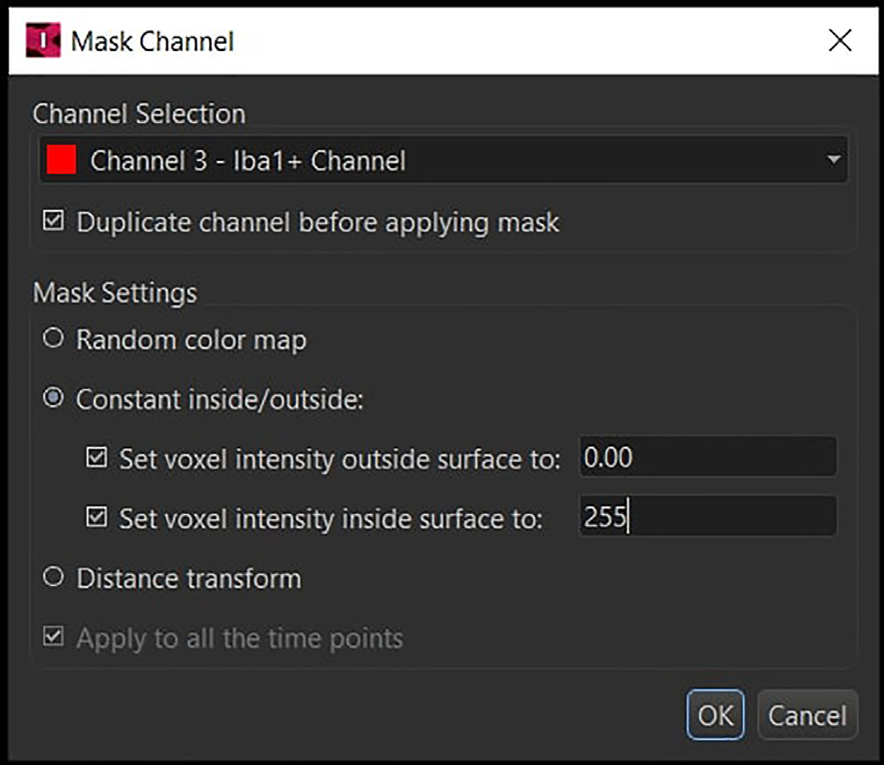

*Mask Channel* dialog: Channel 3 - Iba1+ Channel; **Duplicate channel before applying mask ✓**;
**Constant inside/outside** — outside **0.00**, inside **255**; Apply to all time points ✓.

## fig14 — `fig14_imaris_edit_mask_all.png` (797 × 700), p. 16

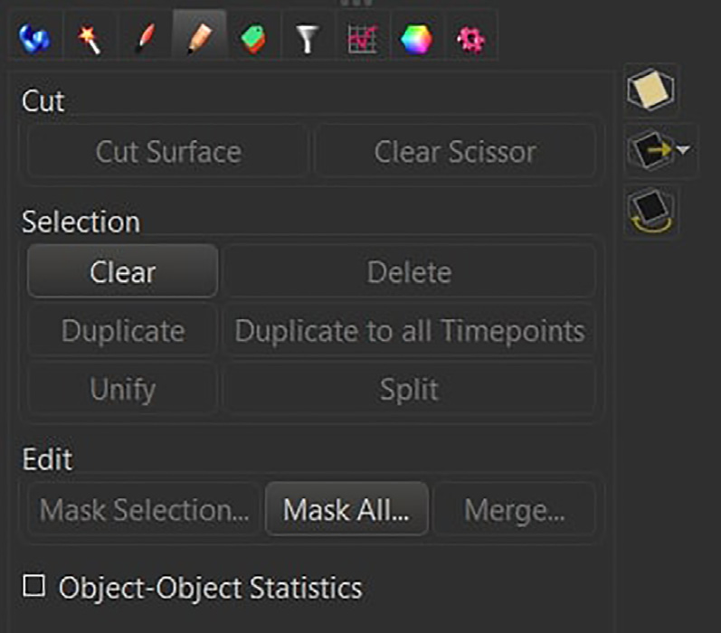

Surfaces *Edit* tab (pencil): Cut, Selection, and **Edit → Mask All…** highlighted;
Object-Object Statistics unchecked.

## fig15 — `fig15_imaris_save_ims.png` (972 × 765), p. 17

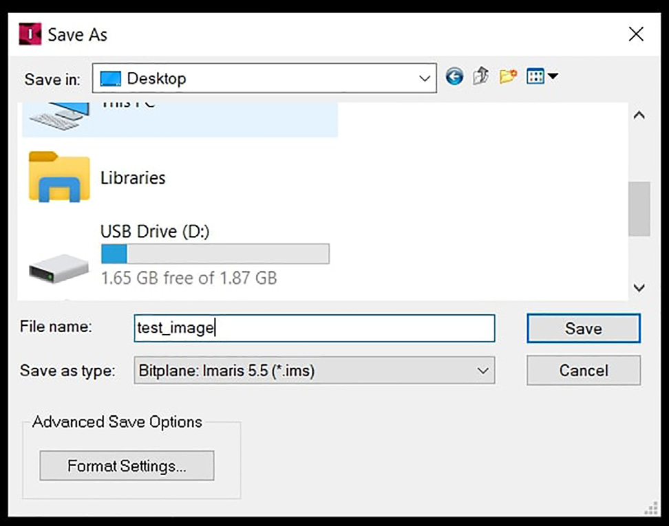

Windows *Save As*: file name `test_image`, type **Bitplane: Imaris 5.5 (\*.ims)**.

## fig16 — `fig16_matlab_featureextract_parameters.png` (797 × 273), p. 17

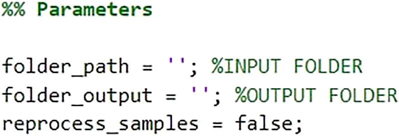

MATLAB code: `%% Parameters` / `folder_path = ''; %INPUT FOLDER` / `folder_output = ''; %OUTPUT
FOLDER` / `reprocess_samples = false;`. The only user-set parameters of `FeatureExtract.m`
shown in the paper — no morphology parameters are exposed here.

## fig17 — `fig17_imaris_delete_channels.png` (797 × 722), p. 17

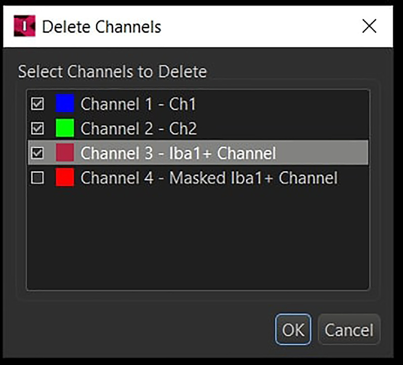

*Delete Channels*: Channel 1 - Ch1 ✓, Channel 2 - Ch2 ✓, Channel 3 - Iba1+ Channel ✓ deleted;
**Channel 4 - Masked Iba1+ Channel** kept. So the raw image had **three channels** (blue,
green, Iba1-red) plus the created mask.

## fig18 — `fig18_trouble_tissue_holes.png` (972 × 637), p. 19 — Problem 1, holes

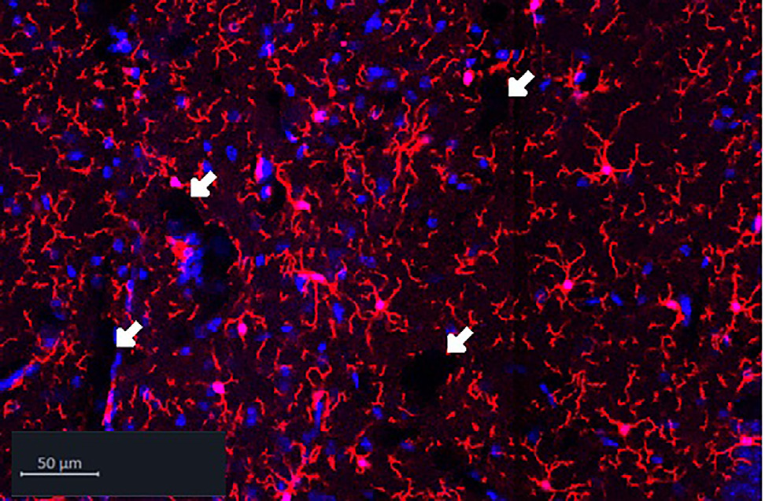

Maximum-projection-style confocal image, **Iba1 red, DAPI blue**, scale bar **50 µm** (100 px →
≈ 0.5 µm/px of this PNG, field ≈ 490 µm). Four white arrows point to **dark holes** in the tissue
(round voids, by eye ≈ 25–50 µm, and a long dark vertical crack).
**What microglia look like:** this is the best view in the paper of normal ramified microglia at
roughly whole-field scale. Cells are **dense and evenly tiled** — a soma every few tens of µm —
each a small bright red/magenta soma (often overlapping a blue nucleus, giving magenta) with
**several (by eye ≈ 4–8) thin, branching processes** radiating out. At this display scale the processes of
neighbouring cells **interdigitate and appear to touch** in projection; the gaps between cells
are filled with fine red process fragments whose parent cell is not obvious. Many DAPI nuclei
(non-microglial) are interspersed. A few brighter, more compact cells occur near the holes.
Expect an algorithm on a projection to struggle to assign processes to cells; in 3D they separate
better.

## fig19 — `fig19_trouble_cutting_stripes.png` (972 × 494), p. 20 — Problem 2, stripes

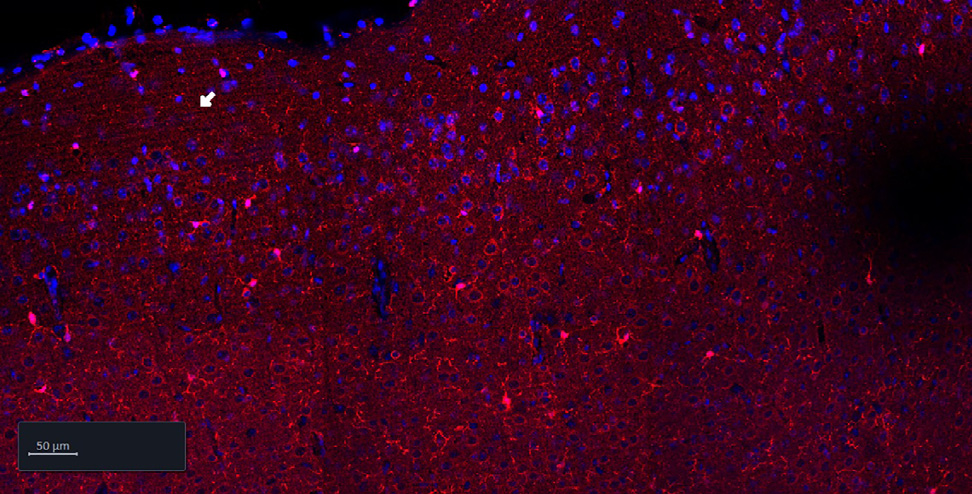

Lower-magnification field (bar **50 µm** = 50 px → ≈ 1 µm/px, field ≈ 970 µm) at a tissue edge
(black top-right = outside tissue), **Iba1 red + DAPI blue**. Faint parallel diagonal **striations**
across the tissue (cryostat chatter; one arrow top-left). A dark shadow on the right.
**What microglia look like here:** at ≈ 1 µm/px only somata (bright magenta dots) and a diffuse
red haze are visible; processes are barely resolved, and the red background is strong. A
cortex-like layered band with denser blue nuclei is visible near the pial edge. **Instructive for
our 20× slide-scanner data:** at this sampling individual process tracing would not be possible.

## fig20 — `fig20_trouble_tile_misalignment.png` (972 × 482), p. 20 — Problem 3, tile seam

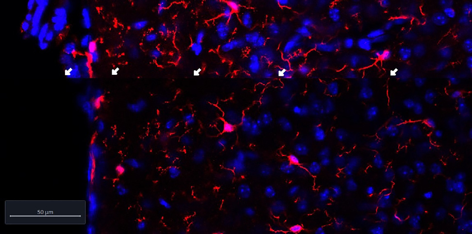

Higher zoom (bar **50 µm** = 146 px → ≈ 0.34 µm/px, field ≈ 330 µm), **Iba1 red, DAPI blue**.
A horizontal **tile seam** about one third down (five arrows) with a lateral shift: processes
crossing it are cut and offset; a dark band to the left where tiles do not meet.
**What microglia look like:** the clearest single-cell view. Somata are bright, oval, roughly
**5–10 µm** across by eye (the saturated cores alone measure ≈ 4–6 µm equivalent diameter by
thresholding this PNG at red > 240 — an underestimate of the soma, quoted only as a magnitude);
processes are **very thin (≈ 1 µm, near the resolution limit), tortuous and beaded**, and break
up into **dotted fragments** wherever they leave the focal range — many isolated red dots in the
field are process pieces, not cells. DAPI nuclei are as large as or larger than microglial somata
and far more numerous.

## fig21 — `fig21_trouble_tear_nonspecific.png` (972 × 947), p. 21 — Problem 4, tear

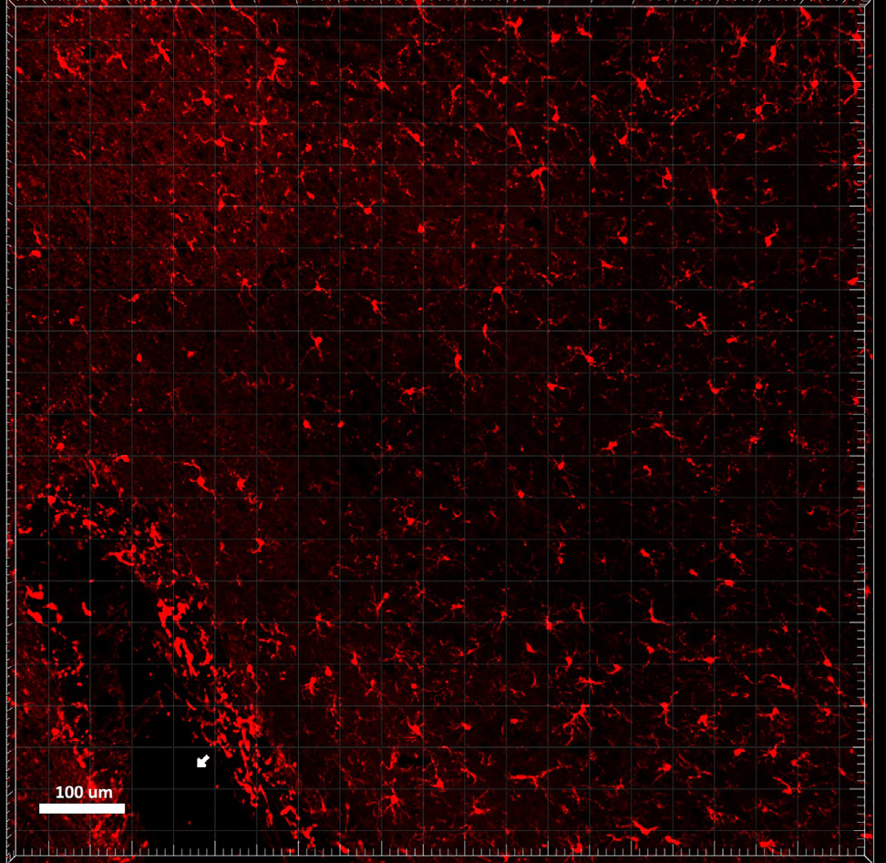

Imaris 3D view (frame grid) of a whole acquisition (bar **100 µm** = 94 px → field ≈ 1,030 µm),
**Iba1 red only**. Bottom-left: a black **tear** (arrow) bordered by large, bright, blobby,
**non-specific** red structures along its edge — these would pass a size filter and be mistaken
for (amoeboid) cells. The rest of the field shows evenly spaced small microglia (soma + short
processes) with a grainy red background; upper-left is hazier.
**Density at whole-field scale:** several hundred somata across the field, regularly spaced
(consistent with the paper's 300–350 analysable cells per image).

## fig22 — `fig22_trouble_dim_stacks.png` (972 × 946), p. 22 — Problem 5, dim region

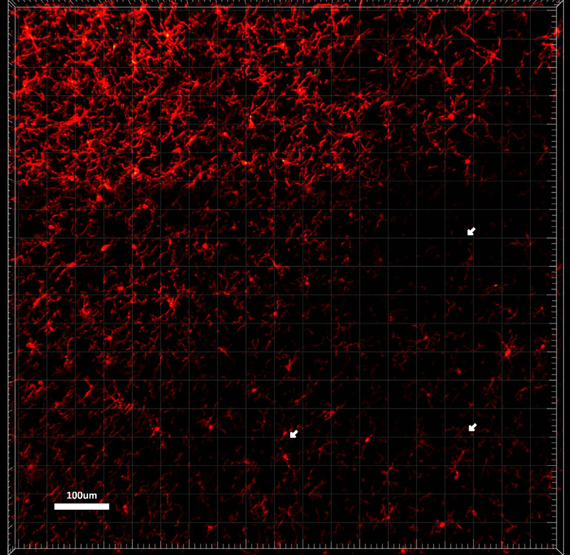

Imaris 3D view of a whole acquisition (bar **100 µm** = 93 px → field ≈ 1,050 µm), **Iba1 red**
(a few tiny green specks top-left). Strong **intensity gradient**: the upper-left third is bright
with a dense, interconnected-looking meshwork of ramified cells; toward lower right the signal
fades, processes become faint dotted lines and somata dim (arrows mark dim cells).
**What it means for an algorithm:** a global threshold would over-segment the bright corner
(cells merging into one network) and lose the dim corner — the reason for per-slice normalisation
and local-contrast thresholding, and for the "exclude if > 4 dim z-slices" rule.
