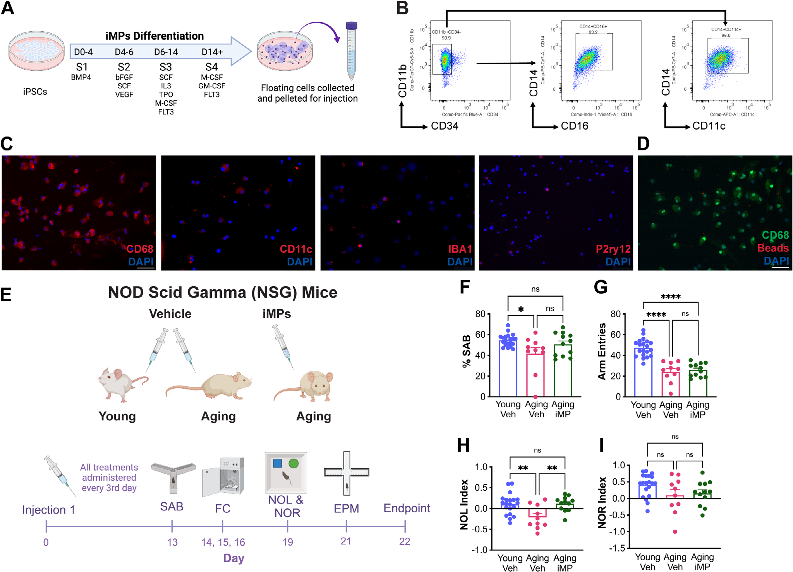
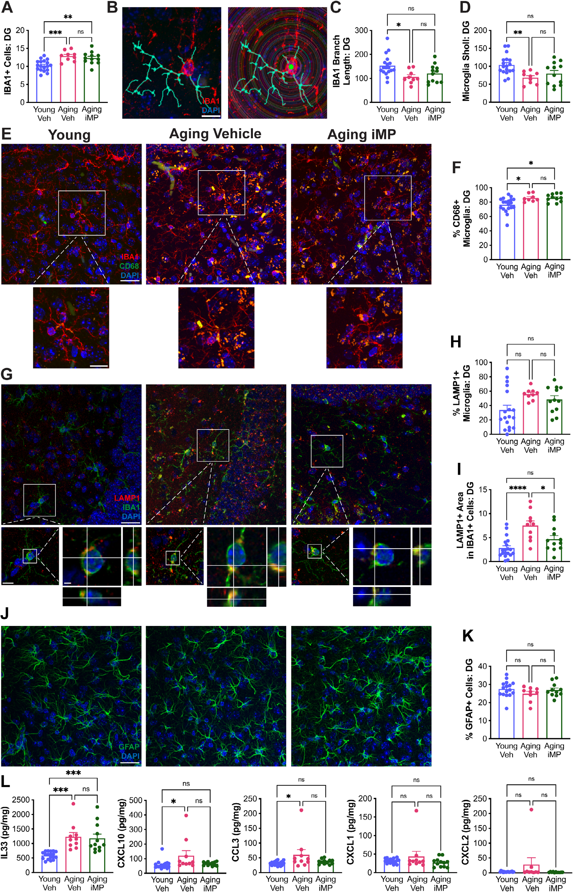
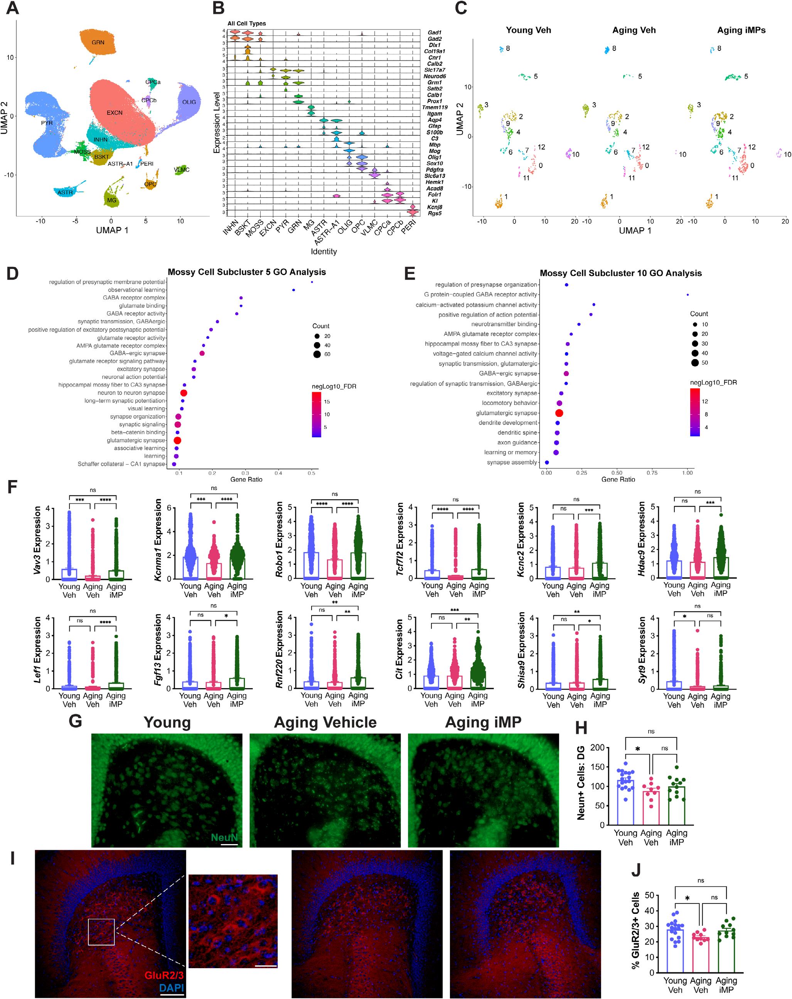
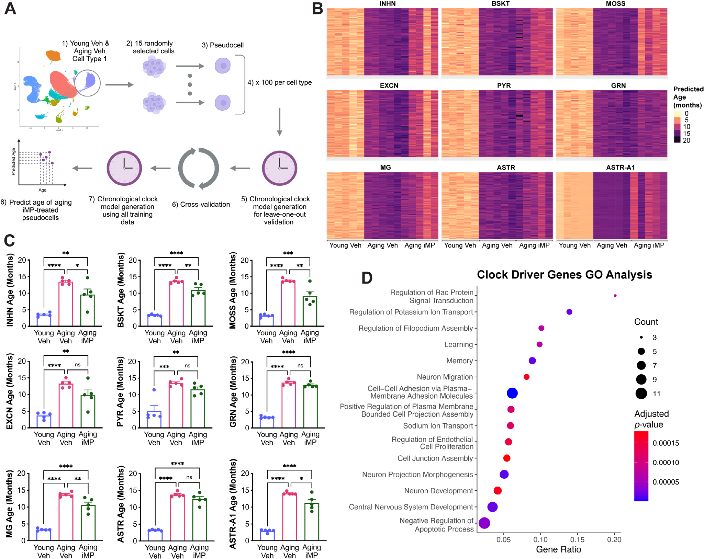
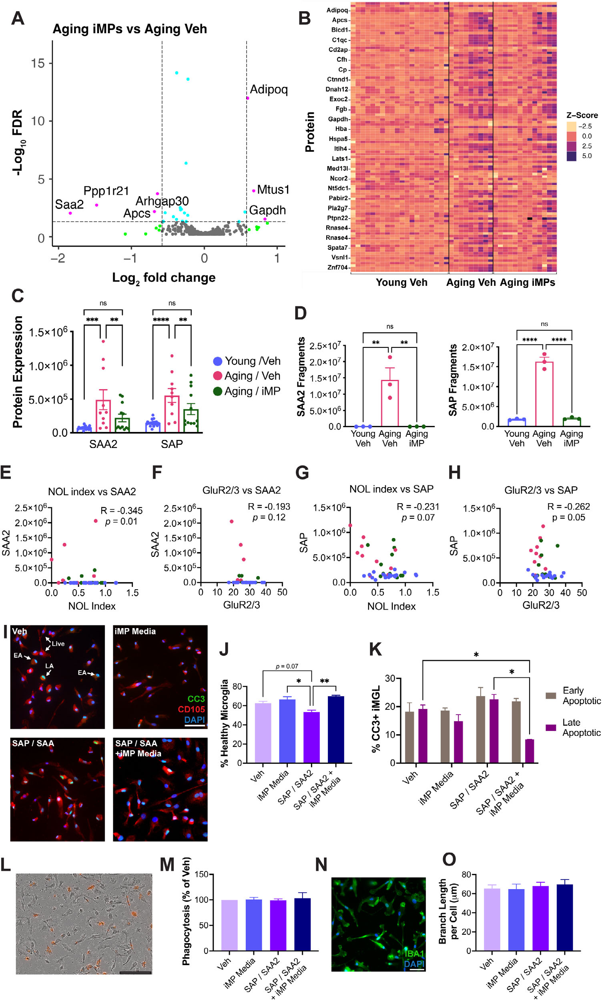
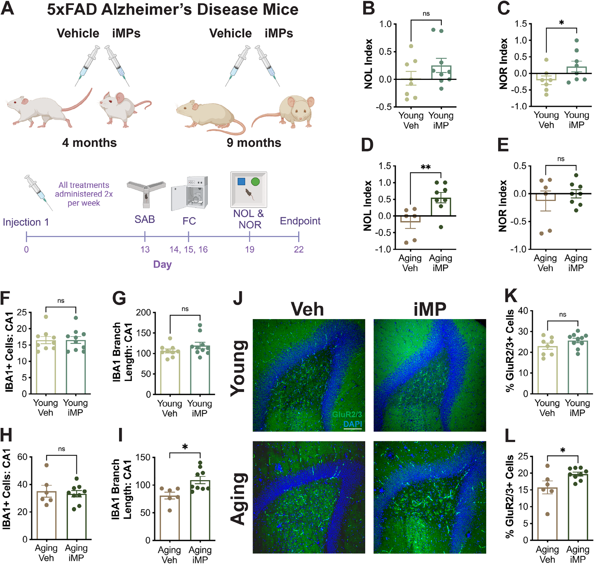

# Figures — Moser et al. 2025

Native-resolution figure images extracted from
[`../moser-2025-ipsc-mononuclear-phagocytes.pdf`](../moser-2025-ipsc-mononuclear-phagocytes.pdf)
(open access under the "Creative Commons Attribution License" — CC BY, version not stated in the PDF — © 2025 The Author(s), *Advanced Science*,
Wiley-VCH; cite DOI 10.1002/advs.202417848). Paper digest: [`../digest.md`](../digest.md).

Each figure is a single embedded raster, saved here as PNG. The only other image in the PDF, the
*Advanced Science News* logo on p. 2, was dropped. Supplementary figures (S1–S9) are **not** in the
PDF (see digest §7).

**Scale-bar measurements.** Bars were measured in pixels off these images with a white-run scan
(lengths below). They give the *figure's* µm/px, not the acquisition pixel size, which the paper
never states. No bar values were assumed: each value is the one printed in the legend.

---

## Figure 1 — `fig1_imp_characterization_behavior.png` (2048 × 1479)

iMP generation and NSG behaviour.

- **A** — schematic of the 4-stage differentiation (S1 D0–4 BMP4; S2 D4–6 bFGF/SCF/VEGF; S3 D6–14
  SCF/IL3/TPO/M-CSF/FLT3; S4 D14+ M-CSF/GM-CSF/FLT3); floating cells collected and pelleted.
- **B** — flow gates: CD11b+CD34− **90.9%** → CD14+CD16+ **93.2%** and CD14+CD11c+ **96.0%**.
- **C** — four ICC panels of cultured iMPs, marker red + DAPI blue: CD68, CD11c, IBA1, P2ry12.
  Scale bar = 50 µm (43 px drawn in the CD68 panel). What we see: small, **round, unramified** cells
  scattered sparsely; CD68 strong and cytoplasmic; IBA1 and P2ry12 nearly absent (a few faint red
  dots). These are monocyte-like cells, *not* microglia — nothing here resembles tissue microglia.
- **D** — CD68 (green) + pHrodo beads (red) + DAPI; scale 50 µm. Rounded green cells, a few red bead
  spots.
- **E** — NSG treatment schematic (Young Veh, Aging Veh, Aging iMP; injections every 3rd day;
  SAB d13, FC d14–16, NOL/NOR d19, EPM d21, endpoint d22).
- **F–I** — bar/dot plots: % SAB, arm entries, NOL index, NOR index (stats in digest §4e).

---

## Figure 2 — `fig2_microglia_iba1_cd68_sholl.png` (1706 × 2652) ⭐

**The figure that matters for the microglia study.** All hippocampal **dentate gyrus**, male NSG.

- **A** — IBA1+ cells: DG (count, no unit/area). Young ≈10, aging ≈13, iMP ≈12.
- **B** — **one traced microglia**, two panels. Left: IBA1 (red) + DAPI (blue) image with the SNT
  tracing overlaid in cyan. Right: the same tracing with **concentric Sholl shells** (multicoloured
  rings) centred on the soma (green dot). Scale bar drawn (55 px) but **its value is not given in
  the legend**. What we see: the soma is a compact red ovoid ≈ 1/10 of the 336-px panel width; the
  tracing has **3 primary processes** leaving the soma (one long one to the upper-left that carries
  most of the arbor, one short upward, one down-right), branching to roughly **20 terminal tips**
  (counted by eye on the tracing), several with small knob-like swellings at branch points. The
  cyan tracing mostly runs over **dark background** in the displayed image: the processes it follows
  are barely visible in this single view, meaning the tracing was done through the z-stack and the
  shown image does not contain the full arbor in focus. **Implication:** thin distal processes are
  near the noise floor even at 63×; a 2D projection-based detector will miss much of what a 3D
  tracer records.
- **C** — IBA1 branch length: DG (axis 0–300, no unit). Young ≈152, aging ≈107, iMP ≈120.
- **D** — Microglia Sholl: DG (AUC, axis 0–200). Young ≈103, aging ≈68, iMP ≈79.
- **E** — **IBA1 (red) / CD68 (green) / DAPI (blue)**, three columns Young / Aging Vehicle / Aging
  iMP; top row overview, bottom row magnified inset of the white box. Legend: scale bar = **25 µm on
  top image** (measured **56 px** → ≈0.45 µm/px at figure resolution; each overview panel is
  **419 × 419 px ≈ 187 µm square**) and **5 µm on bottom image** (measured **52 px**). **The 5 µm
  value is inconsistent with the geometry:** the white ROI box is ≈140 px wide and its inset is
  228 px, a ×1.63 enlargement, so a 52-px inset bar spans ≈32 px ≈ **14–15 µm** of the overview.
  Treat the inset bar as mislabelled (or the inset as not a pure enlargement); trust the 25 µm bar.
  What we see:
  - *Young:* a **continuous lattice of fine red processes filling the entire field** — no empty
    territory; ~6–8 identifiable Iba1 somata (small red-ringed bodies ≈ 5–8 µm, beside the larger
    blue DAPI nuclei of granule/hilar neurons) in ≈187 × 187 µm. Each soma gives off several (≈3–6)
    thin primary processes that branch repeatedly; **arbors of neighbouring cells meet and
    interdigitate**, so where one cell ends and the next begins is not visible in the projection.
    Processes are 1–3 px wide here (≈0.5–1.5 µm). CD68 is sparse: a few faint yellow/orange puncta,
    mostly at somata.
  - *Aging Vehicle / Aging iMP:* the same lattice, slightly thinner and more tangled, with
    **abundant bright orange/yellow CD68 puncta** (CD68 green over IBA1 red) clustered in somata and
    proximal processes, and also scattered over neuronal nuclei. Several **grey-green tubular
    structures** (≈ 5–10 µm wide, elongated, some branched) are blood vessels / autofluorescence,
    not cells. **Caution for us:** in aged tissue some yellow puncta outside obvious Iba1 cells may
    be lipofuscin autofluorescence, which appears in both channels — the paper does not address it.
    A CD68-in-Iba1 measurement must gate puncta by the Iba1 mask and ideally reject puncta bright
    in every channel.
  - Insets: one cell each, soma centred, with 4–6 visible processes; young inset processes long and
    smooth, aged insets shorter with puncta.
- **F** — % CD68+ microglia: DG. Young ≈75, aging ≈86, iMP ≈86.
- **G** — **IBA1 (green) / LAMP1 (red) / DAPI**, Young / Aging Veh / Aging iMP. Top: 25 µm bar
  (measured **56 px**, same 187-µm panels); bottom-left inset "10 µm" (measured **32 px**); the
  orthogonal-view crops "2 µm" (measured **20 px**). Orthogonal (xz/yz) views with white cross-hairs
  show LAMP1 puncta inside the Iba1+ cell body in 3D. What we see: Iba1 in this staining is
  **dimmer and sparser** than in E (different antigen retrieval — EDTA boiling — and green channel);
  ~6–9 somata per field, processes fainter and fragmentary; dense DAPI granule-cell layer visible at
  the edges. Iba1 signal is strongest in the **membrane shell around the soma** (ring around the DAPI
  nucleus in the orthogonal views). Aged panels carry many red/yellow puncta.
- **H** — % LAMP1+ microglia: DG (ns). **I** — LAMP1+ area in IBA1+ cells: DG (young ≈2.8, aging
  ≈7.5, iMP ≈4.7; unit not stated).
- **J** — **GFAP (green) / DAPI**, three columns; 25 µm bar (measured 56 px). Star-shaped astrocytes
  with thick primary processes, evenly tiled, ~20+ per field — morphologically distinct from the
  thin, more tortuous microglial lattice. **K** — % GFAP+ cells (ns).
- **L** — cortical cytokines (pg/mg): IL33, CXCL10, CCL3, CXCL1, CXCL2.

---

## Figure 3 — `fig3_snrnaseq_mossy_cells.png` (2054 × 2593)

- **A** — UMAP of 15 hippocampal clusters (GRN, PYR, EXCN, INHN, MOSS, BSKT, ASTR, ASTR-A1, MG,
  OLIG, OPC, VLMC, CPCa, CPCb, PERI). **B** — violin plot of markers (microglia: *Tmem119*,
  *Itgam*). **C** — mossy-cell subclusters 0–12 split by group (subclusters 5 and 10 depleted in
  aging Veh). **D, E** — GO dot plots for subclusters 5 and 10. **F** — per-gene expression
  (*Vav3, Kcnma1, Robo1, Tcf7l2, Kcnc2, Hdac9, Lef1, Fgf13, Rnf220, Cit, Shisa9, Syt9*).
- **G** — NeuN (green) in DG hilus, scale 25 µm (measured 43 px). **H** — NeuN+ cells: DG
  (young ≈115, aging ≈88, iMP ≈100).
- **I** — GluR2/3 (red) / DAPI in DG, 100 µm bar (61 px) on overview, 25 µm on inset (55 px).
  **J** — % GluR2/3+ cells (young ≈28, aging ≈23, iMP ≈27).

No microglia imagery.

---

## Figure 4 — `fig4_transcriptomic_clocks.png` (2049 × 1628)

- **A** — clock-building schematic (15 random cells → pseudocell, ×100 per cell type; leave-one-out
  cross-validation; predict iMP samples).
- **B** — heatmaps of predicted age (0–20 months) per pseudocell for INHN, BSKT, MOSS, EXCN, PYR,
  GRN, **MG**, ASTR, ASTR-A1.
- **C** — predicted ages per group; MG: young ≈3, aging Veh ≈14, aging iMP ≈11 (**).
- **D** — GO of 160 clock-driver genes.

No images.

---

## Figure 5 — `fig5_plasma_proteomics_imgl.png` (1504 × 2498)

- **A** — volcano, aging iMP vs aging Veh (labelled: Saa2, Ppp1r21, Apcs, Arhgap30 down; Adipoq,
  Mtus1, Gapdh up). **B** — heatmap of the 109 aging-DE proteins. **C, D** — SAA2 and SAP by
  discovery proteomics and PRM. **E–H** — correlations with NOL index and GluR2/3.
- **I** — iMGL: CC3 (green) / CD105 (red) / DAPI, four conditions; scale 50 µm (50 px). Arrows mark
  live, early-apoptotic (EA) and late-apoptotic (LA) cells. Cultured microglia are **elongated,
  bipolar or few-process cells**, sparse, not overlapping.
- **J, K** — % healthy, % CC3+ (early/late). **L** — pHrodo zymosan phase image, scale 200 µm.
  **M** — phagocytosis (% of Veh).
- **N** — iMGL IBA1 (green) / DAPI, scale 50 µm (35 px). Cells are spindle/bipolar or with 2–4
  short processes, scattered with little contact — a far simpler shape than tissue microglia.
- **O** — **Branch length per cell (µm)**: ≈65–70 in every condition (ns).

---

## Figure 6 — `fig6_5xfad_microglia_mossy.png` (2051 × 1948)

- **A** — 5xFAD schematic, start at 4 or 9 months, twice weekly.
- **B–E** — NOL/NOR indices (young: NOR *; aging: NOL **).
- **F, H** — IBA1+ cells: CA1 (young ≈16 vs ≈16; aging ≈35 vs ≈33; ns).
- **G, I** — IBA1 branch length: CA1 (young ≈105 vs ≈118 ns; aging ≈80 vs ≈108 *).
- **J** — GluR2/3 (green) / DAPI in DG, Young/Aging × Veh/iMP; 100 µm bar (62 px). Green
  vessel-like streaks are visible in the hilus. **K, L** — % GluR2/3+ cells.

No microglia images for 5xFAD — only the plotted numbers.
